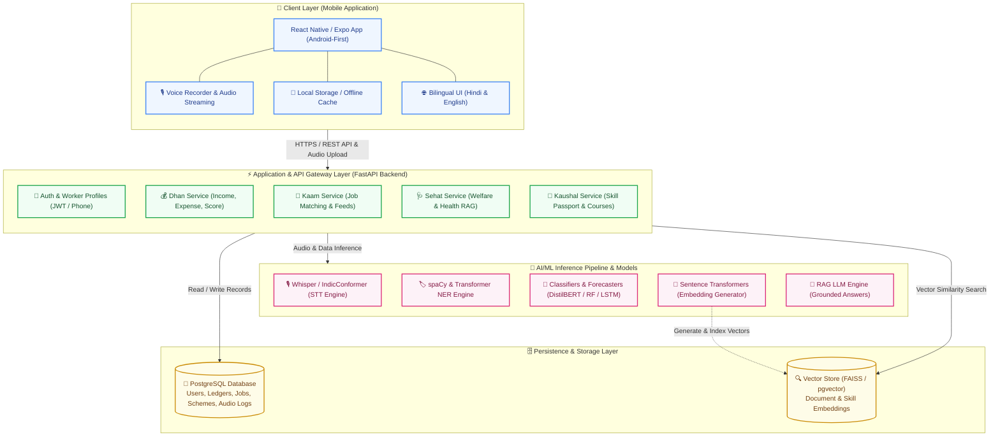
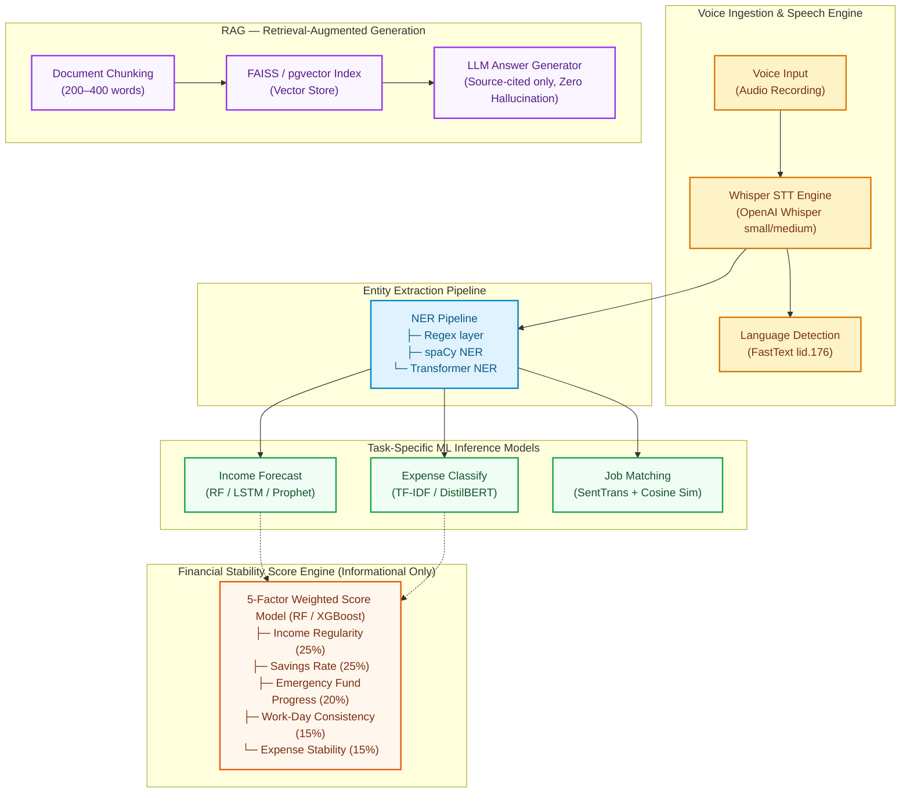
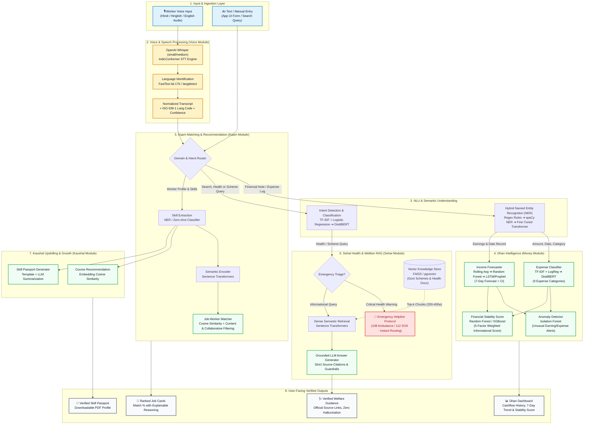
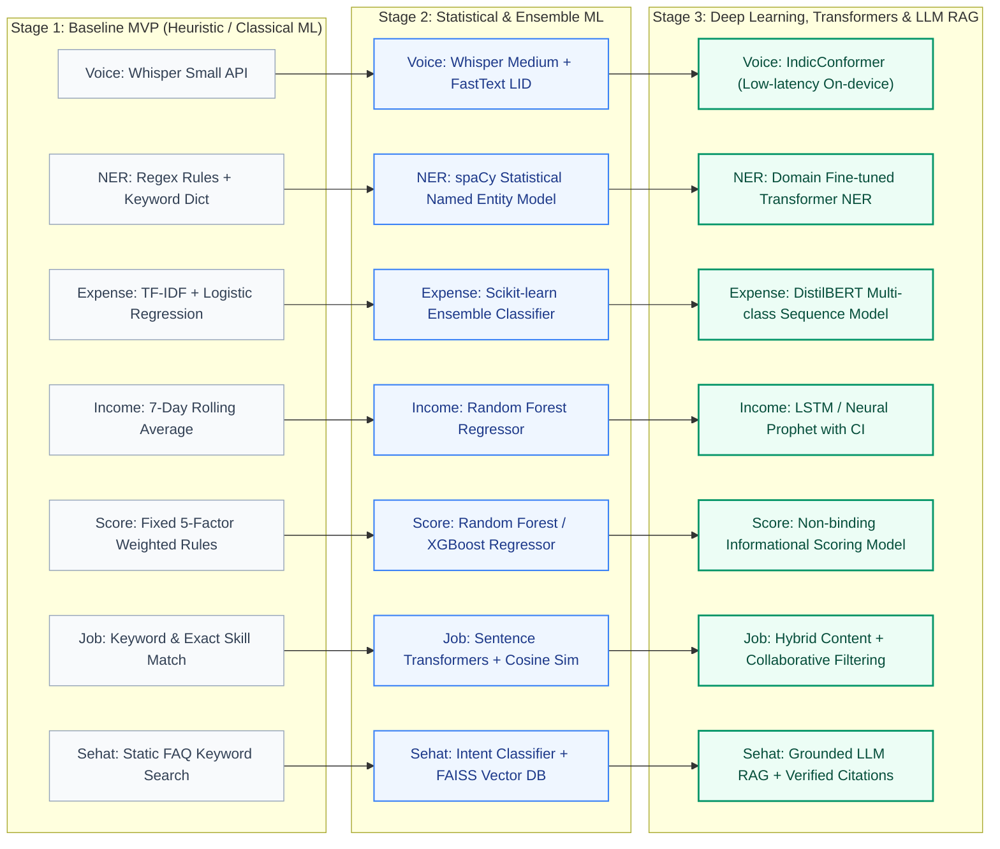

<p align="center">
  
  
  
  
  
</p>

<h1 align="center">सेतु — Setu</h1>
<h3 align="center">AI-Powered Livelihood Companion for India's Informal & Gig Workers</h3>
<p align="center"><em>"Aapke Kaam, Paisa, Sehat aur Skill ka Sathi"</em></p>

---

## 🏗️ Overview

**Setu** (meaning "bridge" in Hindi) is an AI-powered mobile application that acts as a livelihood companion for India's estimated **450 million informal and gig workers** — construction labourers, electricians, domestic workers, drivers, delivery personnel, street vendors, plumbers, tailors, and daily-wage earners.

The app bridges the gap between:
- A worker's **skills** and nearby **work opportunities** via ML-driven job matching
- **Irregular daily income** and **planned savings** via intelligent forecasting
- **Health needs** and **verified public resources** via Retrieval-Augmented Generation (RAG)
- **Informal experience** and a structured **digital Skill Passport** via NER-based skill extraction

> **Legal Disclaimer:** Setu is an informational and record-keeping tool only. It does **not** constitute legal, medical, employment, or financial advice. It does not make automated decisions regarding employment eligibility, loan approvals, insurance claims, welfare benefits, or medical diagnoses. Users must verify all information with official government sources or qualified professionals before acting on any suggestion.

---

## 🏛️ System Architecture

Setu follows a 4-tier modular architecture designed for offline resilience, low latency, and strict privacy compliance:



---

## 🤖 AI/ML Architecture

Setu's intelligence layer is designed as a **multi-model pipeline** combining classical ML, deep learning, and large language models — each selected for a specific task with explainability and fairness constraints.

### Model Map

| Module | Task | Model / Approach | Output |
|---|---|---|---|
| **Voice** | Speech-to-Text (Hindi/English) | OpenAI Whisper `small`/`medium`, IndicConformer | Transcript + language code + confidence | 
| **Voice** | Language Identification | FastText `lid.176.bin` / `langdetect` | ISO 639-1 language code | 
| **Money** | Named Entity Recognition | spaCy NER → Transformer NER (fine-tuned) | Amount, date, category, work-type entities | 
| **Money** | Expense Classification | TF-IDF + Logistic Regression → DistilBERT | 9-class expense category | 
| **Money** | Income Forecasting | Rolling Average → Random Forest → LSTM/Prophet | 7-day income forecast with confidence interval | 
| **Money** | Anomaly Detection | Isolation Forest | Unusual income/expense alerts | 
| **Money** | Financial Stability Score | Random Forest / XGBoost (5-factor weighted) | 0–100 informational score | 
| **Kaam** | Job-Worker Matching | Sentence Transformers + Cosine Similarity | Ranked jobs with match % and explainability | 
| **Kaam** | Recommendation Engine | Content-based + Collaborative Filtering | Personalized work suggestions | 
| **Sehat** | Intent Detection | Logistic Regression → DistilBERT | Health / scheme / work / money intent | 
| **Sehat** | Information Retrieval (RAG) | Sentence Transformers + FAISS/pgvector + LLM | Source-linked answers with citations | 
| **Kaushal** | Skill Extraction | NER / Zero-shot Classifier | Structured skill taxonomy | 
| **Kaushal** | Course Recommendation | Embedding Similarity | Recommended upskilling courses | 
| **Kaushal** | Profile Generation | Template + LLM Summarization | Downloadable Skill Passport PDF | 

### 🧩 ML Pipeline Architecture



---

### 🗺️ AI/ML End-to-End Pipeline Architecture



---

### 📈 AI/ML Model Evolutionary Progression Roadmap

Each intelligence component follows an incremental development path from explainable heuristics to state-of-the-art transformer and deep learning models:



---

### 🗓️ Phased Development & Implementation Roadmap


#### Financial Stability Score Breakdown (Informational Only)
- **Income Regularity (25%):** Variance of day-to-day income over a 30-day window
- **Savings Rate (25%):** Net surplus percentage saved over monthly earnings
- **Emergency Fund Progress (20%):** Progress towards 30-day baseline buffer
- **Work-Day Consistency (15%):** Predictability of active working days per week
- **Expense Stability (15%):** Non-volatile recurring expense profile

---

## ⚖️ Legal, Ethics & AI Safety Framework

Setu follows a **responsible AI framework** with strict guardrails around automated decision-making, data privacy, and worker protection.

### Legal Compliance

| Regulation / Principle | Setu's Compliance |
|------------------------|-------------------|
| **IT Act, 2000 (India)** | All data transmitted over HTTPS; sensitive personal data encrypted at rest |
| **DPDP Act, 2023 (India)** | Data minimization; explicit consent; right to erasure; purpose limitation |
| **Right to Privacy (Puttaswamy)** | No Aadhaar, biometric, or financial credential collection |
| **EU AI Act (Transparency)** | All AI outputs are explainable; no opaque automated decisions |
| **No Automated Decision-Making** | Financial score is informational only; not shared with lenders/employers |

### AI Fairness & Bias Mitigation

- **Job Matching Fairness:** Recommendations tested across gender, city, occupation, and language groups to prevent discriminatory ranking
- **Income Forecasting Limitations:** Seasonal workers receive wider confidence intervals; system does not penalize irregular earners
- **Financial Score Guardrails:** Explicitly labeled as non-binding; never used for creditworthiness assessment, loan eligibility, or insurance decisions
- **Explainability Mandate:** Every AI recommendation includes a human-readable reason (e.g., "यह काम सुझाया गया क्योंकि इसमें वायरिंग और फैन रिपेयर स्किल मैच हुई।")

### Data Privacy Architecture

```
┌────────────────────────────────────────────┐
│           DATA COLLECTED (Minimal)          │
│  ✅ Mobile number    ✅ Name                │
│  ✅ City/locality    ✅ Occupation + Skills  │
│  ✅ Income/Expense   ✅ Optional location    │
├────────────────────────────────────────────┤
│         DATA NEVER COLLECTED                │
│  ❌ Aadhaar number   ❌ Bank passwords      │
│  ❌ UPI PINs         ❌ Full ID documents   │
│  ❌ Exact live GPS   ❌ Health records      │
│  ❌ Biometric data   ❌ Caste/religion      │
├────────────────────────────────────────────┤
│         AUDIO DATA HANDLING                 │
│  • Process → Transcript → Delete raw audio │
│  • No raw audio retention without consent   │
│  • No voice data used for public model      │
│    training without explicit informed consent│
└────────────────────────────────────────────┘
```

### Safety Disclaimers (Embedded in App)

| Domain | Disclaimer |
|--------|-----------|
| **Medical** | "Setu चिकित्सा सलाह नहीं देता। कृपया आधिकारिक स्रोत से पुष्टि करें।" |
| **Financial** | "यह स्कोर केवल जानकारी के लिए है, लोन निर्णय के लिए नहीं।" |
| **Employment** | Job listings include source, pay range, location, and "Verify before joining" warning |
| **General** | "Setu केवल सूचना और सुझाव देने के लिए है। यह कानूनी, चिकित्सा, या वित्तीय सलाह नहीं देता।" |

### Health Emergency Protocol

When a worker reports emergency symptoms, Setu:
1. Immediately displays emergency numbers (108 Ambulance, 112 Emergency)
2. Shows nearest verified government health facilities
3. **Never** provides treatment instructions or diagnoses

---

## 📱 Current Implementation (Frontend Demo)

This repository contains the **Phase 1 frontend prototype** — a demo-ready UI built with:

- **Expo SDK 57** + **React Native 0.86**
- **Expo Router** (file-based routing)
- **TypeScript** (strict mode)
- **Custom styled components** (no external UI library)

### Screens Implemented

| # | Screen | Route | Description |
|---|--------|-------|-------------|
| 1 | Onboarding | `/onboarding` | Language selection (Hindi/English) + worker type |
| 2 | Home (होम) | `/(tabs)/` | Greeting, income card, voice CTA, job suggestions |
| 3 | Kaam (काम) | `/(tabs)/kaam` | Job listings with skill filters + empty state |
| 4 | Dhan (पैसा) | `/(tabs)/dhan` | Income chart, expenses, savings, financial score |
| 5 | Voice Modal | Modal overlay | Listening → result → saved (3-stage UX) |
| 6 | Sehat (सेहत) | Via "सेवा" tab | Health resources, emergency numbers, search |
| 7 | Kaushal (कौशल) | Via "सेवा" tab | Skill Passport, profile, courses |

### Design System

| Token | Value |
|-------|-------|
| Primary | `#0F766E` (Deep Teal) |
| Accent | `#F59E0B` (Saffron) |
| Background | `#FAF7F2` (Off-white) |
| Card Radius | `16px` |
| Min Touch Target | `48 × 48px` |
| Body Text | `16px` |
| Income Numbers | `36–48px bold` |

---

## 🚀 Getting Started

### Prerequisites

- Node.js ≥ 20.x
- npm or yarn
- Expo Go app on Android phone (for device testing)

### Installation

```bash
# Clone the repository
git clone https://github.com/sadiasakharkar/fairwork-setu.git
cd fairwork-setu/setu-app

# Install dependencies
npm install

# Start the development server
npx expo start
```

### Running on Device

1. Install **Expo Go** from Google Play Store
2. Run `npx expo start`
3. Scan the QR code with Expo Go

---

## 📁 Project Structure

```
fairwork-setu/
├── 01_PROJECT_DESCRIPTION.md      # Product vision and user pain points
├── 02_PROBLEM_STATEMENT.md        # Problem analysis
├── 03_REQUIREMENTS.md             # Functional/non-functional requirements
├── 04_ARCHITECTURE.md             # System architecture
├── 05_UI_UX_DESIGN.md             # UI/UX specification
├── 06_AI_ML_SPECIFICATION.md      # ⭐ Complete AI/ML model map and pipeline
├── 07_DATASET_SPECIFICATION.md    # Dataset design for training
├── 08_DATABASE_SCHEMA.md          # Database schema design
├── 09_API_SPECIFICATION.md        # API endpoint specification
├── 10_DEVELOPMENT_PLAN.md         # Development roadmap
├── 11_EVALUATION_METRICS.md       # ML evaluation metrics
├── 12_ETHICS_PRIVACY_SAFETY.md    # ⭐ Legal, ethics, and safety framework
├── 13_AGENT_HANDOFF.md            # Agent handoff specification
└── setu-app/                      # ⭐ React Native frontend
    ├── app/                       # Expo Router screens
    │   ├── _layout.tsx            # Root stack navigator
    │   ├── index.tsx              # Entry redirect
    │   ├── onboarding.tsx         # Language + worker type selection
    │   └── (tabs)/               # Bottom tab navigator
    │       ├── _layout.tsx        # Tab configuration
    │       ├── index.tsx          # Home screen
    │       ├── kaam.tsx           # Work discovery screen
    │       ├── dhan.tsx           # Money tracker screen
    │       └── more.tsx           # Services hub (Sehat + Kaushal)
    ├── components/                # Reusable UI components
    │   ├── Card.tsx
    │   ├── PrimaryButton.tsx
    │   ├── SectionHeader.tsx
    │   ├── IncomeCard.tsx
    │   ├── JobCard.tsx
    │   ├── HealthResourceCard.tsx
    │   ├── SavingsProgressCard.tsx
    │   ├── SkillChip.tsx
    │   ├── VoiceButton.tsx
    │   ├── VoiceEntryModal.tsx
    │   ├── EmptyState.tsx
    │   ├── DisclaimerText.tsx
    │   ├── SehatScreen.tsx
    │   └── KaushalScreen.tsx
    ├── constants/
    │   └── theme.ts               # Design tokens
    └── data/
        └── mockData.ts            # Mock data for demo
```

---
---

## 🛡️ Responsible AI Principles

1. **Assistive, Not Decisive** — AI suggests; humans decide
2. **Explainable** — Every recommendation shows its reasoning
3. **Source-Linked** — Health/welfare answers cite official sources
4. **Privacy-First** — Minimal data collection; no biometric/Aadhaar storage
5. **Fair** — Tested across gender, language, geography, and occupation
6. **Safe** — No medical diagnosis, no loan approval, no employment guarantees
7. **Transparent** — Users can view, edit, and delete all their data

---

## 📄 License

This project is licensed under the MIT License — see the [LICENSE](LICENSE) file for details.

---

<p align="center">
  <strong>सेतु — Building bridges to better livelihoods through responsible AI</strong>
</p>
