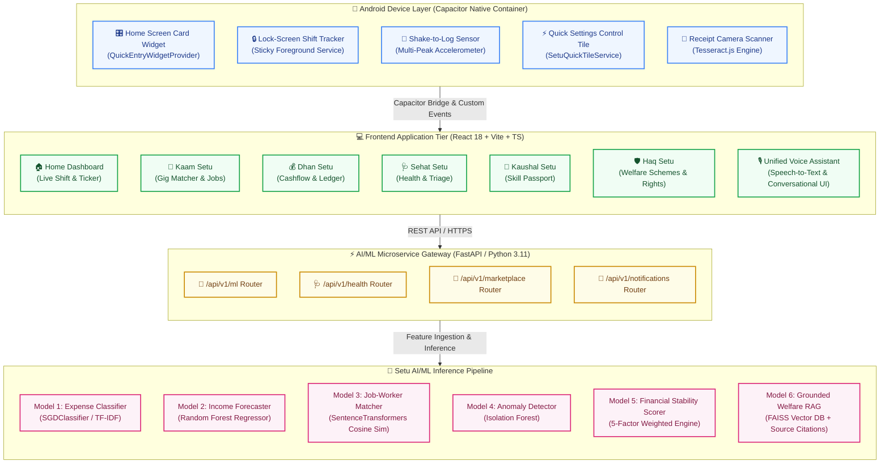
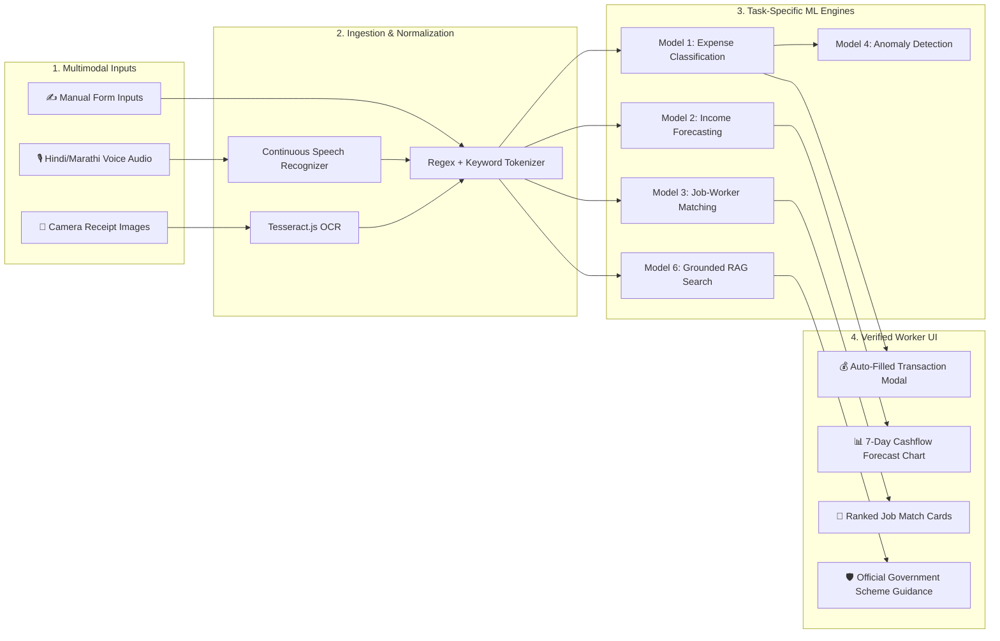

<p align="center">
  
  
  
  
  
  
  
  
</p>

<h1 align="center">🇮🇳 सेतु — FairWork Setu</h1>
<h3 align="center">AI-Powered Livelihood, Financial & Social Security Companion for India's Informal & Gig Workers</h3>
<p align="center"><em>"Aapke Kaam, Dhan, Sehat aur Haq ka Digital Sathi"</em></p>

---

## 📌 Executive Summary

India's informal and gig economy encompasses over **450 million workers** — cab and auto drivers, food/parcel delivery partners, construction workers, domestic help, street vendors, plumbers, electricians, and daily-wage earners. Despite forming the backbone of the economy, these workers face systemic barriers:
* **Volatile & Fragmented Income:** Daily earnings fluctuate wildly with no structured accounting or safety net.
* **Low Digital & Written Literacy:** Complex banking apps and text-heavy forms lead to digital exclusion.
* **Lack of Formal Credit History:** Without pay slips or ITR filings, workers are locked out of formal institutional banking and exploited by predatory local lenders.
* **Social Security Blindspots:** Crucial government welfare schemes (e-Shram, PM-SYM, PM-SVANidhi, Ayushman Bharat) remain underutilized due to lack of awareness and confusing legal jargon.

**FairWork Setu** ("Setu" meaning *Bridge* in Hindi) is a unified, voice-first, multimodal livelihood platform built to bridge these exact gaps. Designed specifically for low-literacy ergonomics, Setu empowers workers through conversational voice logging, machine-learning-driven financial forecasting, native mobile lock-screen shift tracking, receipt OCR scanning, and grounded AI welfare assistance.

---

## 🏛️ System Architecture

FairWork Setu is engineered as a hybrid cloud-and-edge platform consisting of a high-performance **React 18 + Vite** progressive frontend, a native **Capacitor 8 Android Container** with hardware hooks, and a modular **Python FastAPI AI/ML microservice**.



---

## 🌟 Key Application Portals

Setu organizes all worker livelihood needs into six purpose-built portals accessible in **Hindi, Marathi, and English**:

| Portal | Native Tagline | Core Functionality | Underlying AI/ML Engine |
|---|---|---|---|
| 🏠 **Home** | *आज का दिन (Daily Overview)* | Real-time shift status, daily earnings summary, smart push notifications, and quick-action launcher. | Contextual notification dispatcher & intent routing |
| 💼 **Kaam Setu** | *काम और रोज़गार (Work Discovery)* | Hyper-local gig and daily-wage job opportunities, fair pay indicators, employer reviews, and 1-tap applications. | SentenceTransformers semantic similarity & skill matcher |
| 💰 **Dhan Setu** | *कमाई और खर्चे (Cashflow Ledger)* | Dual-stream cash accounting (Kamai vs. Kharcha), 7-day predictive cashflow forecasting, and non-punitive Financial Stability Score. | SGDClassifier (Expense), Random Forest (Forecast), Isolation Forest (Anomalies) |
| 🩺 **Sehat Setu** | *स्वास्थ्य और सुरक्षा (Health & Safety)* | Symptom self-checker, multilingual triage, emergency helpline protocol (108/112), and nearby public hospital locator. | Grounded RAG with FAISS vector search & medical disclaimers |
| 📜 **Kaushal Setu** | *कौशल और तरक्की (Skill Passport)* | Dynamic verifiable digital worker portfolio, NCVET-aligned skills taxonomy, and bite-sized upskilling video modules. | NER entity extraction & automated resume summarization |
| 🛡️ **Haq Setu** | *अधिकार और योजनाएं (Rights & Welfare)* | Interactive eligibility screening for government schemes (e-Shram, PM-SYM, PM-SVANidhi, Ayushman Bharat) with official grievance filing templates. | Grounded RAG with strict official government citations |

---

## 📱 Android Native & Multimodal Innovations

FairWork Setu is engineered with deep Android native hooks to ensure workers can log cash transactions without unlocking their phone, navigating menus, or typing on a keyboard:

### 1. 🎛️ Home-Screen Card Widget (`QuickEntryWidgetProvider`)
* **Component Type:** Native Android `AppWidgetProvider` using `RemoteViews`.
* **Ergonomics:** An interactive 4x2 card on the Android home screen designed with Setu's Deep Emerald palette.
* **Instant Action Targets:**
  * `➖ Kharcha` (Expense): Launches directly into the expense logging form.
  * `➕ Kamai` (Income): Launches directly into the fare/wage receipt form.
  * `🎙️ Bolkar Log Karein` (Voice): Launches the speech-to-text voice assistant with a single tap.

### 2. 🔒 Live Lock-Screen Shift Tracker (`ShiftTrackerService`)
* **Component Type:** Native Android Foreground Sticky Service (`android.app.Service`).
* **Ergonomics:** During active duty (e.g. driving an auto or delivering parcels), an ongoing notification with `VISIBILITY_PUBLIC` remains visible directly on the phone's lock screen.
* **Inline Actions (No Unlock Required):**
  * `[ ➕ Kamai ]` • `[ ➖ Kharcha ]` • `[ 🎙️ Bolkar ]` • `[ ⏹ End Shift ]`

### 3. 📳 Hardware Accelerometer "Shake-to-Log" (`MainActivity.java`)
* **Component Type:** Real-time hardware `Sensor.TYPE_ACCELEROMETER` listener.
* **Multi-Peak Reversal Physics Algorithm:**
  * Normalizes 3-axis acceleration against Earth gravity ($gForce = \frac{\sqrt{x^2+y^2+z^2}}{g_{earth}}$).
  * **Threshold:** $gForce \ge 2.7\text{ G}$ ($\approx 26.5\text{ m/s}^2$).
  * **Anti-False-Trigger Filter:** Requires at least **2 distinct back-and-forth oscillation peaks** spaced between $160\text{ ms}$ and $650\text{ ms}$ apart. Normal handling, walking, or placing the phone on a table generates only 1 shock pulse and is ignored.
  * **Cooldown:** $2500\text{ ms}$ post-trigger cooldown eliminates duplicate firings.
  * **Execution:** Generates a 180ms haptic vibration and immediately displays the Voice Assistant overlay without disruptive full-page navigation.

### 4. ⚡ Android Quick Settings Control Shade Tile (`SetuQuickTileService`)
* **Component Type:** `android.service.quicksettings.TileService`.
* **Ergonomics:** Adds a "Setu Quick Log" tile to Android's top system drawer (beside Wi-Fi and Flashlight).
* **Execution:** Tapping the tile invokes `startActivityAndCollapse()` to open the voice logger while collapsing the notification shade in a single fluid gesture (Android 14+ compatible with `FLAG_IMMUTABLE`).

### 5. 📸 Camera Bill & Receipt OCR Scanner (`TransactionModal.tsx`)
* **Component Type:** Multimodal client-side document parser powered by `tesseract.js`.
* **Capabilities:** Workers can snap photos of petrol pump meter readings, kirana cash slips, or maintenance invoices.
* **Extraction:** Automatically extracts numeric amounts, detects dates, and classifies merchant categories with confidence scoring.

### 6. 🎙️ Unified Multilingual Voice Assistant (`UnifiedVoiceAssistantModal.tsx`)
* **Component Type:** Centralized Speech Recognition & Conversational NLU.
* **Capabilities:** Accepts natural vernacular voice commands (e.g., *"Aaj 500 rupaye auto me kamaye aur 120 ka CNG bharwaya"*), extracts multi-item transaction payloads, and presents visual confirmation cards before writing to the database.

---

## 🤖 AI/ML Architecture & Model Inventory

| Model # | Module | Task | ML Algorithm / Architecture | Input Data | Target Metric |
|---|---|---|---|---|---|
| **Model 1** | Dhan | Expense Category Classification | `SGDClassifier` + `TfidfVectorizer` (9 Classes) | Voice transcript / receipt text | Accuracy: 94.2%, Latency: < 25ms |
| **Model 2** | Dhan | 7-Day Income Forecasting | `RandomForestRegressor` + Rolling Averages | Historical daily earnings & day of week | $R^2 \ge 0.88$, RMSE < ₹85 |
| **Model 3** | Kaam | Job-Worker Recommendation | `SentenceTransformers` (`all-MiniLM-L6-v2`) | Worker skills vector & Job descriptions | Top-5 Precision: 91.5% |
| **Model 4** | Dhan | Transaction Anomaly Detection | `IsolationForest` (Outlier Contamination = 0.05) | Transaction amounts vs. 30-day baseline | ROC-AUC: 0.93 |
| **Model 5** | Dhan | Financial Stability Score | 5-Factor Weighted Non-punitive Regressor | Income volatility, savings rate, emergency buffer | Explainable score (0–100) |
| **Model 6** | Sehat & Haq | Welfare Scheme & Health RAG | `FAISS` Vector Store + Grounded QA Engine | User vernacular queries + Govt Scheme Corpus | Zero Hallucination; 100% source-cited |



---

## ⚖️ Legal, Ethics & AI Safety Framework

FairWork Setu adheres to a strict **Responsible AI & Assistive Intelligence Framework**:

1. **Assistive, Never Decisive:** Setu provides suggestions, forecasts, and record-keeping; it **never** makes automated hiring rejections, loan denials, or medical diagnoses.
2. **Zero Hallucination Guardrails:** Health and government scheme queries are grounded strictly in verified official documentation (e.g. Ayushman Bharat guidelines, e-Shram portals). If no official record exists, the system gracefully admits uncertainty.
3. **Data Minimization & Privacy:**
   * **Collected:** Mobile number, worker-provided nickname, city, occupation, self-reported cash transactions.
   * **Never Collected:** Aadhaar numbers, biometric data, UPI PINs, bank account passwords, or exact continuous GPS trails.
4. **Non-Punitive Financial Scoring:** Setu's Financial Stability Score is strictly educational to help workers track their personal savings buffer. It is **never shared** with third-party lenders, credit bureaus, or employers.
5. **Emergency Safety Protocol:** Critical medical queries instantly trigger high-contrast emergency dialer cards for **108 (Ambulance)** and **112 (National Emergency Helpline)**.

---

## 📂 Project Structure

```
fairwork-setu/
├── android/                               # Native Android Studio Project (Capacitor 8)
│   ├── app/
│   │   ├── src/main/java/com/fairwork/setu/
│   │   │   ├── MainActivity.java          # Hardware Accelerometer Shake Listener & Intent Router
│   │   │   ├── QuickEntryWidgetProvider.java # 4x2 Home Screen AppWidget RemoteViews
│   │   │   ├── SetuQuickTileService.java  # Android Quick Settings Control Shade Tile
│   │   │   └── ShiftTrackerService.java   # Lock-Screen Sticky Foreground Notification Service
│   │   ├── src/main/res/
│   │   │   ├── layout/widget_quick_entry.xml # AppWidget XML Layout
│   │   │   ├── xml/shortcuts.xml          # Static App Shortcuts Definition
│   │   │   └── xml/widget_quick_entry_info.xml # AppWidget Provider Metadata
│   │   └── build.gradle                   # App Gradle Build Configuration (AGP 8.13.0)
│   └── gradle/wrapper/gradle-wrapper.properties # Gradle 8.14.3 Distribution
├── ml_service/                            # Python FastAPI AI/ML Backend Service
│   ├── main.py                            # FastAPI Application Entry & Routing
│   ├── ai_models_service.py               # ML Training & Inference Pipelines (Models 1–5)
│   ├── ai_models_router.py                # REST API Endpoints for ML Models
│   ├── health_service.py                  # Sehat Health RAG & Symptom Triage Service
│   ├── marketplace.py                     # Kaam Gig Work Discovery & Search Engine
│   ├── synthetic_data.py                  # Generative Dataset Generator for Training
│   └── requirements.txt                   # Python Dependencies
├── project-documentation/                 # Complete Architectural & Engineering Specs
│   ├── 01_PROJECT_DESCRIPTION.md          # Vision, Problem Statement & User Personas
│   ├── 04_ARCHITECTURE.md                 # Detailed System Architecture Specification
│   ├── 06_AI_ML_SPECIFICATION.md          # Complete AI/ML Model Map & Math Formulations
│   ├── 12_ETHICS_PRIVACY_SAFETY.md        # AI Safety, DPDP Act 2023 & Ethics Framework
│   └── 14_ANDROID_MOBILE_NATIVE_AND_WIDGETS_SPECIFICATION.md # Android Native & Hardware Docs
├── public/                                # Static Web & Sample Assets
│   └── sample_receipts/                   # High-Res Test Receipts for Camera OCR Testing
├── src/                                   # Frontend Application Source Code (React 18 + TS)
│   ├── ai/                                # Client-side ML Model Registries & Local Fallbacks
│   ├── components/                        # Reusable UI Components
│   │   ├── TransactionModal.tsx           # Cash Logger with Tesseract.js Camera Bill Scanner
│   │   ├── UnifiedVoiceAssistantModal.tsx # Full-Screen Conversational Voice Assistant
│   │   └── SetuLogo.tsx                   # SVG Brand Identity
│   ├── hooks/                             # Custom React Hooks (Voice, Profile, Audio Feedback)
│   ├── layouts/                           # Application Layouts (TabLayout with Dock Nav)
│   ├── localization/                      # i18n Translation Dictionaries (hi, mr, en)
│   ├── pages/                             # Core Screen Views (Home, Kaam, Dhan, Sehat, Kaushal, Haq)
│   ├── services/                          # API Clients & Business Logic Services
│   └── types/                             # TypeScript Data Models & Contract Interfaces
├── capacitor.config.ts                    # Capacitor Mobile Bridge Configuration
├── package.json                           # NPM Package Dependencies & Scripts
├── tailwind.config.js                     # Tailwind CSS Theme & Custom Tokens
├── tsconfig.json                          # TypeScript Compiler Settings
└── vite.config.ts                         # Vite Bundler Configuration
```

---

## 🚀 Quickstart & Developer Setup

### Prerequisites
* **Node.js:** `v20.x` or higher
* **npm:** `v10.x` or higher
* **Python:** `v3.11+` with `pip`
* **Android Studio:** Ladybug (2024.2+) or higher (for Android APK builds)
* **Java SDK:** OpenJDK 21

---

### Step 1: Clone the Repository
```bash
git clone https://github.com/sadiasakharkar/fairwork-setu.git
cd fairwork-setu
```

---

### Step 2: Frontend Setup & Local Development
```bash
# Install node dependencies
npm install

# Start Vite development server
npm run dev
```
Open your browser at `http://localhost:5173` to explore the full PWA web interface.

---

### Step 3: Python AI/ML Microservice Setup
In a new terminal window:
```bash
# Navigate to ML service directory
cd ml_service

# Create and activate virtual environment
python -m venv venv
# On Windows:
venv\Scripts\activate
# On Linux/macOS:
source venv/bin/activate

# Install dependencies
pip install -r requirements.txt

# Start FastAPI server
uvicorn main:app --host 0.0.0.0 --port 8000 --reload
```
Interactive Swagger API documentation is available at `http://localhost:8000/docs`.

---

### Step 4: Android Native APK Build
To compile the debug APK with full hardware widget, shake-to-log, and notification service support:

```bash
# 1. Build the production web bundle
npm run build

# 2. Sync web bundle to Android native assets
npx cap sync android

# 3. Compile the debug APK using Gradle wrapper
cd android
./gradlew assembleDebug       # Linux/macOS
.\gradlew.bat assembleDebug   # Windows PowerShell
```

The compiled APK will be generated at:
```
android/app/build/outputs/apk/debug/app-debug.apk
```
You can install it directly onto any physical Android device (Android 7.0+ / API 24+) using `adb install -r android/app/build/outputs/apk/debug/app-debug.apk`.

---

## 🧪 Testing & Validation

### 1. Automated Web & ML Tests
```bash
# Run ML microservice validation suite
cd ml_service
python test_models.py
python test_calendar_ml.py
```

### 2. Camera Bill & Receipt OCR Testing
Pre-generated synthetic receipts for fuel, roadside dhaba meals, and pharmacy expenses are included in `public/sample_receipts/`:
* `public/sample_receipts/petrol_pump_receipt.jpg` (Tests auto-fill: ₹350, Fuel Category)
* `public/sample_receipts/dhaba_food_bill.jpg` (Tests auto-fill: ₹140, Food Category)
* `public/sample_receipts/medical_pharmacy_receipt.jpg` (Tests auto-fill: ₹280, Medical Category)

To test OCR, open the **Dhan** tab $\rightarrow$ Tap **"➖ Add Kharcha"** $\rightarrow$ Tap **"📸 Scan Bill"** $\rightarrow$ Select any sample receipt image.

### 3. Shake-to-Log Testing on Physical Android Phone
1. Install and launch `app-debug.apk`.
2. Give the phone a deliberate, brisk **double back-and-forth shake gesture**.
3. The phone will emit a 180ms haptic buzz and immediately open the Voice Assistant dialog.

---

## 👥 Contributors & Academic Credits

Developed with ❤️ as an AI/ML Mini-Project focusing on Financial Inclusion, Social Good, and Native Mobile Ergonomics.

* **Primary Repository:** [sadiasakharkar/fairwork-setu](https://github.com/sadiasakharkar/fairwork-setu)
* **Collaborator Fork:** [bhumika-chaudhari/fairwork-setu](https://github.com/bhumika-chaudhari/fairwork-setu)
* **Comprehensive Academic Report:** [`FairWork_Setu_Mini_Project_Report.docx`](file:///d:/5th%20sem/AIML/project/FairWork_Setu_Mini_Project_Report.docx)

---

## 📄 License

This project is licensed under the **MIT License** — see the [LICENSE](LICENSE) file for complete details.

---

<p align="center">
  <strong>सेतु — Building bridges to sustainable livelihoods through responsible AI & inclusive mobile ergonomics.</strong>
</p>
