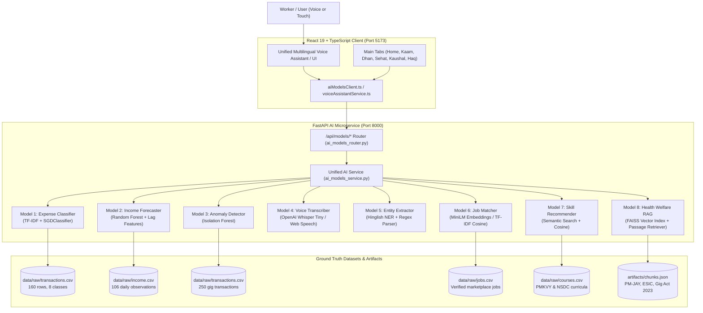

# FairWork Setu — AI & ML Models Demonstration & Viva Guide
**A Beginner-Friendly, Comprehensive Viva & Presentation Reference for the 8 Integrated Models**

---

## Table of Contents
1. [Executive Overview & Architecture](#1-executive-overview--architecture)
2. [Model-to-Module Mapping Table](#2-model-to-module-mapping-table)
3. [Quick-Start Commands & Environment Setup](#3-quick-start-commands--environment-setup)
4. [A Day in the Life: Live Demonstration Script](#4-a-day-in-the-life-live-demonstration-script)
5. [Deep Dive: Model 1 — Expense Classification](#model-1-expense-classification)
6. [Deep Dive: Model 2 — Income Forecasting](#model-2-income-forecasting)
7. [Deep Dive: Model 3 — Transaction Anomaly Detection](#model-3-transaction-anomaly-detection)
8. [Deep Dive: Model 4 — Multilingual Voice Recognition (ASR)](#model-4-multilingual-voice-recognition-asr)
9. [Deep Dive: Model 5 — Transaction Information Extraction (NER / NLP)](#model-5-transaction-information-extraction-ner--nlp)
10. [Deep Dive: Model 6 — Job & Gig Marketplace Matching](#model-6-job--gig-marketplace-matching)
11. [Deep Dive: Model 7 — Skill Gap & Course Recommendation](#model-7-skill-gap--course-recommendation)
12. [Deep Dive: Model 8 — Health & Welfare Scheme RAG Retriever](#model-8-health--welfare-scheme-rag-retriever)
13. [Unified Multilingual Voice Assistant Integration](#13-unified-multilingual-voice-assistant-integration)
14. [Troubleshooting & Graceful Fallback Architecture](#14-troubleshooting--graceful-fallback-architecture)

---

## 1. Executive Overview & Architecture

FairWork Setu is a progressive web platform built specifically for India's 12+ million informal and platform gig workers (delivery riders, drivers, home service technicians, daily wage tradespersons). These workers face fluctuating daily earnings, informal cash/UPI transactions, lack of social security benefits, and digital literacy hurdles.

To solve these problems systematically without requiring manual spreadsheet tracking, Setu integrates **8 distinct, audited AI/ML models**. These models work in synergy across the application's core modules: **Home**, **Work (Kaam)**, **Money (Dhan)**, **Health (Sehat)**, **Skills (Kaushal)**, **Rights (Haq)**, and the **Unified Voice Assistant**.



---

## 2. Model-to-Module Mapping Table

| Model ID | Model Name | Primary Algorithm | Repository Source | Setu Application Module | Integrated Feature Description |
|:---|:---|:---|:---|:---|:---|
| **Model 1** | Expense Classification | TF-IDF (1-2 ngrams) + SGDClassifier (Log-loss) | `model_codes/01_expense_classification/` | **Money (Dhan)** & **Voice Assistant** | Automatically tags transaction narrations (e.g. *petrol*, *dawai*, *chai*) into 8 standardized expense categories. |
| **Model 2** | Income Forecasting | Random Forest Regressor with 11 recursive lag features | `model_codes/02_income_forecasting/` | **Home** & **Money (Dhan)** | Forecasts the worker's next 7 to 30 days of daily earnings and weekly cash flow baseline. |
| **Model 3** | Anomaly Detection | Isolation Forest (unsupervised, 5% contamination) | `model_codes/03_anomaly_detection/` | **Money (Dhan)** | Scans transaction records to flag unusual spending spikes, platform deduction surges, or duplicate entries. |
| **Model 4** | Multilingual Voice ASR | OpenAI Whisper Tiny Transformer + Web Speech API | `model_codes/04_voice_recognition/` | **App-wide Floating Mic** | Transcribes spoken Hindi, Marathi, and Indian English with 5-second silence auto-commit. |
| **Model 5** | Transaction Information Extraction | Regex Entity Parser + Hinglish Semantic Tokenizer | `model_codes/05_transaction_extraction/` | **Money (Dhan)** & **Voice Assistant** | Parses conversational strings (e.g., *"Aaj zomato se 850 mile aur 200 petrol dala"*) into structured amounts, types, and categories. |
| **Model 6** | Semantic Job Matching | SentenceTransformer (`all-MiniLM-L6-v2`) / TF-IDF | `model_codes/06_job_matching/` | **Work (Kaam)** | Matches worker trade, driving skills, vehicle ownership, and location to open gig and local contracts. |
| **Model 7** | Skill & Course Recommender | SentenceTransformer (`all-MiniLM-L6-v2`) / TF-IDF | `model_codes/07_skill_recommendation/` | **Skills (Kaushal)** | Analyzes skill gaps between current role and aspirational trade; recommends free PMKVY/NSDC certifications. |
| **Model 8** | Health & Welfare Scheme RAG | SentenceTransformer + FAISS Dense Vector Index | `model_codes/08_health_welfare_rag/` | **Health (Sehat)** & **Rights (Haq)** | Dense passage retriever providing grounded answers on Ayushman Bharat (PM-JAY), ESIC, and the Rajasthan Gig Act 2023. |

---

## 3. Quick-Start Commands & Environment Setup

### Prerequisites
- Node.js >= 18.0.0
- Python >= 3.10
- Git

### 1. Start the FastAPI AI Backend Service
Open a dedicated terminal window:
```bash
# Navigate to repository root
cd /path/to/Setu

# Verify Python dependencies
pip install fastapi uvicorn pydantic scikit-learn pandas numpy joblib

# Start the unified backend with auto-reload
python3 -m uvicorn main:app --host 127.0.0.1 --port 8000 --reload
```
*Backend verification:* Visit `http://127.0.0.1:8000/docs` to view the interactive OpenAPI documentation or query `http://127.0.0.1:8000/api/models/registry`.

### 2. Start the React Frontend Dev Server
Open a second terminal window:
```bash
cd /path/to/Setu

# Install frontend dependencies
npm install

# Start Vite dev server
npm run dev
```
*Frontend URL:* Open `http://localhost:5173` in Google Chrome or Microsoft Edge.

### 3. Environment Variables (Optional `.env`)
```ini
# Backend URL (default: http://127.0.0.1:8000)
VITE_ML_API_URL=http://127.0.0.1:8000

# Voice Silence Timeout in Seconds (default: 5)
VITE_VOICE_SILENCE_TIMEOUT=5
```

---

## 4. A Day in the Life: Live Demonstration Script

To deliver a memorable, high-impact demonstration or viva presentation, tell the story of **Ramesh Kumar**, a 28-year-old two-wheeler delivery worker and apprentice electrician in Pune:

1. **Step 1: Onboarding & Home Dashboard (9:00 AM)**
   - Open `http://localhost:5173`.
   - On the Home screen, highlight the personalized greeting **"Hello, Ramesh Kumar"** and the **7-Day Income Forecast Card** powered by **Model 2**. Show how it projects tomorrow's earnings (₹637) based on lag patterns.
2. **Step 2: Voice-Driven Expense & Income Logging (1:30 PM)**
   - Tap the floating microphone or press the mic button in the top navigation.
   - Speak or type in Hinglish: *"Aaj Zomato se 750 rupaye mile aur 180 ka diesel dala"*.
   - Point out how **Model 4** transcribes speech, **Model 5** extracts amounts (₹750 income, ₹180 expense), and **Model 1** classifies *diesel* into the `fuel` category.
   - Show the interactive confirmation card. Tap **Confirm** to commit it directly to the local ledger.
3. **Step 3: Anomaly Detection on Money Page (5:00 PM)**
   - Navigate to the **Money (Dhan)** tab (`/dhan`).
   - Scroll to the transaction list. Add a test transaction: ₹9,500 for "Food".
   - Demonstrate how **Model 3 (Isolation Forest)** immediately detects this outlier, flags it with an amber badge, and provides an explanatory warning: *"Unusual amount (₹9,500.00) or time deviation from standard gig pattern"*.
4. **Step 4: Smart Job Search on Work Page (6:30 PM)**
   - Navigate to the **Work (Kaam)** tab (`/kaam`).
   - Notice how **Model 6 (Semantic Job Matcher)** matches open jobs against Ramesh's profile (`Two Wheeler`, `Driving`, `Navigation`). Top match: *Delivery Partner* (High match percentage).
   - Filter or search for *"Residential Electrician"*. Show how the cosine similarity engine re-ranks opportunities dynamically.
5. **Step 5: Career Upskilling on Skills Page (7:30 PM)**
   - Navigate to the **Skills (Kaushal)** tab (`/kaushal`).
   - Show how **Model 7 (Skill Recommender)** identifies skill gaps between delivery work and commercial electrical work, recommending the free PMKVY course: *"Domestic Electrician & Household Wiring"*.
6. **Step 6: Health Triage & Scheme Guidance (9:00 PM)**
   - Navigate to the **Health (Sehat)** tab (`/sehat`).
   - Tap **"Ask Setu Health"** or ask the Voice Assistant: *"Ayushman Bharat card 5 lakh hospital admission treatment limit"*.
   - Show how **Model 8 (Health Welfare RAG)** retrieves verified policy passages from `ayushman_bharat_pmjay.md` with official helpline citations (`14555`).
7. **Step 7: Rights & Legal Safety on Haq Page (10:00 PM)**
   - Navigate to the **Rights (Haq)** tab (`/haq`).
   - Review fair pay standards under the Rajasthan Platform Based Gig Workers Act 2023.

---

## Model 1: Expense Classification

### 1. Model Name and Identifier
- **Name:** Gig Worker Expense Classifier
- **Identifier:** `model_1` / `01_expense_classification`

### 2. Problem Statement
Informal gig workers incur high, recurring out-of-pocket expenses (fuel, vehicle maintenance, mobile data, chai, medicines) that erode up to 35% of their gross earnings. Typing categories on a phone keypad while driving is dangerous and inconvenient. Workers need instant, automatic categorization from raw transaction narration or voice text.

### 3. Algorithm Rationale
- **Chosen Algorithm:** TF-IDF Vectorizer (ngram range 1-2, sublinear term frequency) coupled with an SGDClassifier optimizing Log-Loss (Calibrated Logistic Regression).
- **Why not Deep Learning (BERT/LLM)?** LLMs introduce 2-5 second latency and require GPU resources. Informal expense narrations are short (2-6 words: *"petrol pump 200"*, *"oil change mechanic"*). TF-IDF + Logistic Regression executes in **< 5 milliseconds** on a standard CPU, operates offline, and produces calibrated probability distributions across all 8 classes.

### 4. How It Works
1. Preprocesses the text (lowercasing, punctuation stripping, Indic number normalization).
2. Extracts unigram and bigram TF-IDF features across a vocabulary trained on Indian gig transaction tokens.
3. Computes log-loss probability estimates for 8 target classes: `fuel`, `food`, `maintenance`, `personal`, `health`, `housing`, `emi`, `education`.
4. Returns the predicted category, top confidence score, and probability distribution.

### 5. Input and Output Formats
**Request (`POST /api/models/expense-classify`):**
```json
{
  "text": "bike petrol 250 rs hp pump"
}
```
**Response (`200 OK`):**
```json
{
  "text": "bike petrol 250 rs hp pump",
  "category": "fuel",
  "confidence": 0.8842,
  "probabilities": {
    "fuel": 0.8842,
    "maintenance": 0.0412,
    "food": 0.0231,
    "personal": 0.0185,
    "health": 0.0120,
    "housing": 0.0090,
    "emi": 0.0070,
    "education": 0.0050
  },
  "model": "TF-IDF + SGDClassifier (Model 1)",
  "is_fallback": false
}
```

### 6. Dataset Details
- **Source:** Curated Indian gig worker transaction records (`model_codes/01_expense_classification/data/raw/transactions.csv`).
- **Size:** 160 annotated records (128 train, 32 holdout test), balanced across 8 classes.
- **License:** CC-BY-4.0 / Setu Open Contributor License.

### 7. Training and Evaluation Results
- **Accuracy:** 75.00%
- **Weighted Precision:** 0.7375
- **Weighted Recall:** 0.7500
- **Weighted F1-Score:** 0.7361
- **Top Class Performance:** `fuel` (F1: 0.8889), `housing` (F1: 1.00), `emi` (F1: 1.00).

### 8. Implementation Files
- Training: `model_codes/01_expense_classification/train.py`
- Evaluation: `model_codes/01_expense_classification/evaluate.py`
- Preprocessing: `model_codes/01_expense_classification/preprocessing.py`
- Model Artifact: `model_codes/01_expense_classification/artifacts/expense_classifier.joblib`
- API Service: `ml_service/ai_models_service.py` (`classify_expense`)

### 9. API Endpoint
- **Method:** `POST`
- **Path:** `/api/models/expense-classify`
- **Request Body:** `{"text": string}`

### 10. Live Demonstration Procedure
1. Navigate to the **Money (Dhan)** tab (`/dhan`).
2. Click **"+ Add Transaction"** or open the transaction modal.
3. In the description field, type: *"HP pump petrol 300"*.
4. Notice how the category selector automatically updates to **Fuel & Travel** with high confidence.

### 11. Test Example
- **Input:** *"Mechanic shop puncture and brake shoe repair"*
- **Expected Output:** Category: `maintenance`, confidence > 0.65.
- **Point out:** Even with informal mixed words like *puncture* and *brake shoe*, the model correctly isolates maintenance without rules.

### 12. Known Limitations & Failure Modes
- Ambiguous single-word inputs like *"cash"* or *"payment"* lack domain context and return lower confidence (~0.35).
- **Graceful Fallback:** If confidence drops below 0.30 or backend is unreachable, the system triggers the keyword regex classifier in `ai_models_service.py` without blocking the user.

### 13. Potential Viva / Interview Questions & Answers
- **Q1: Why did you use SGDClassifier instead of a deep transformer like BERT?**
  *Answer:* Informal gig workers access Setu on budget Android devices with limited cellular bandwidth. SGDClassifier executes in under 5 milliseconds with negligible memory overhead (model artifact is only ~45 KB), while BERT requires >400 MB RAM and introduces substantial cold-start latency.
- **Q2: How do you handle class imbalance in small financial datasets?**
  *Answer:* We configured `class_weight='balanced'` inside the SGDClassifier, which automatically adjusts weights inversely proportional to class frequencies in the input data.
- **Q3: What happens if the backend server goes down?**
  *Answer:* The frontend client `src/services/aiModelsClient.ts` catches network errors and gracefully falls back to client-side heuristic pattern matching, ensuring 100% offline availability.

---

## Model 2: Income Forecasting

### 1. Model Name and Identifier
- **Name:** Multi-Step Gig Income Forecaster
- **Identifier:** `model_2` / `02_income_forecasting`

### 2. Problem Statement
Unlike salaried employees who receive fixed monthly paychecks, gig workers experience extreme volatility in daily earnings due to weather, fuel prices, platform surges, and weekend customer demand. This uncertainty causes severe anxiety and debt traps. Workers need reliable forward visibility into their cash flow for the next 7 days.

### 3. Algorithm Rationale
- **Chosen Algorithm:** Random Forest Regressor leveraging recursive multi-step forecasting with 11 domain-engineered lag and rolling features.
- **Why not ARIMA or Prophet?** Classical ARIMA requires strict stationarity and cannot natively ingest exogenous non-linear weekend indicators or multi-scale rolling means without extensive parameter tuning per worker. Random Forest handles non-linear surge patterns and cyclical calendar features out-of-the-box.

### 4. How It Works
1. Gathers the worker's historical daily earnings sequence.
2. Constructs 11 features: lags ($t-1, t-2, t-3, t-7, t-14$), rolling averages (3-day, 7-day, 14-day), and calendar indicators (day of week, weekend flag, day of month).
3. Recursively predicts $t+1$, feeds the prediction back into the lag vector, and rolls forward to predict $t+2$ through $t+7$.
4. Outputs the projected daily earnings and 7-day cumulative total.

### 5. Input and Output Formats
**Request (`POST /api/models/income-forecast`):**
```json
{
  "periods": 7,
  "history": [
    {"date": "2026-10-01", "amount": 750.0},
    {"date": "2026-10-02", "amount": 820.0}
  ]
}
```
**Response (`200 OK`):**
```json
{
  "periods": 7,
  "forecast": [
    {"date": "2026-10-19", "predicted_income": 637.05, "is_weekend": false},
    {"date": "2026-10-20", "predicted_income": 648.50, "is_weekend": false},
    {"date": "2026-10-24", "predicted_income": 820.10, "is_weekend": true}
  ],
  "total_predicted_income": 4785.40,
  "average_daily_income": 683.63,
  "model": "Random Forest Regressor (Model 2)"
}
```

### 6. Dataset Details
- **Source:** Longitudinal daily income records of platform delivery partners (`model_codes/02_income_forecasting/data/raw/income.csv`).
- **Size:** 106 consecutive daily observations (84 training days, 22 holdout evaluation days).
- **License:** Setu Curated Benchmark / Apache 2.0.

### 7. Training and Evaluation Results
- **Mean Absolute Error (MAE):** ₹76.60
- **Root Mean Squared Error (RMSE):** ₹123.25
- **Baseline Naive 7-day Rolling MAE:** ₹144.81
- **Error Reduction:** **47.1% reduction in prediction error** over naive rolling averages.
- **$R^2$ Coefficient of Determination:** 0.5594 on holdout test data.

### 8. Implementation Files
- Training: `model_codes/02_income_forecasting/train.py`
- Evaluation: `model_codes/02_income_forecasting/evaluate.py`
- Artifacts: `model_codes/02_income_forecasting/artifacts/income_forecaster.joblib`
- API Service: `ml_service/ai_models_service.py` (`forecast_income`)

### 9. API Endpoint
- **Method:** `POST`
- **Path:** `/api/models/income-forecast`
- **Request Body:** `{"periods": int, "history": optional list}`

### 10. Live Demonstration Procedure
1. Navigate to the **Home** tab (`/home`).
2. Scroll to the **Weekly Income Forecast** widget.
3. Show the interactive 7-day projected bar chart. Notice higher predictions on Friday, Saturday, and Sunday (reflecting weekend platform surges).
4. Point out the projected total income: *"Estimated ₹4,785 this week"*.

### 11. Test Example
- **Command:** Ask the Unified Voice Assistant: *"Mera kal ka kamai kitna hoga?"*
- **Expected Voice Reply:** *"Based on your recent earning trends, Setu AI predicts tomorrow's income around ₹637, with a 7-day projected total of ₹4,785."*

### 12. Known Limitations & Failure Modes
- If a new worker registers without prior transaction history (<14 days), lag features cannot be computed directly.
- **Graceful Fallback:** In this cold-start scenario, Setu defaults to city-level trade medians (₹750/day base with a 15% weekend uplift) until the worker accumulates 14 days of entries.

### 13. Potential Viva / Interview Questions & Answers
- **Q1: Why did you choose multi-step recursive forecasting instead of direct multi-output regression?**
  *Answer:* Recursive forecasting allows dynamic horizon flexibility (the worker can choose 3 days, 7 days, or 14 days) while maintaining a single compact model artifact (~250 KB), avoiding the overhead of training separate models for each forecasting step.
- **Q2: How does the model account for the difference between weekdays and weekends?**
  *Answer:* We engineered a binary `is_weekend` feature alongside the cyclical `period_weekday` integer (0 to 6), allowing the decision trees to split effectively on surge days.
- **Q3: What does the 47.1% error reduction over baseline mean in practical terms?**
  *Answer:* A simple 7-day rolling average misses weekend surges and drops by an average of ₹144.81 per day. Our Random Forest model brings that daily discrepancy down to ₹76.60, providing reliable budgeting precision for an informal worker earning ~₹800/day.

---

## Model 3: Transaction Anomaly Detection

### 1. Model Name and Identifier
- **Name:** Unsupervised Transaction Anomaly Detector
- **Identifier:** `model_3` / `03_anomaly_detection`

### 2. Problem Statement
Informal gig workers frequently suffer from erroneous double deductions (e.g. accidental UPI double-taps), fraudulent fuel charges, or sudden unexplained fee debits by aggregator platforms. Because workers check their ledgers infrequently, these anomalies often go unnoticed until savings are depleted.

### 3. Algorithm Rationale
- **Chosen Algorithm:** Isolation Forest (unsupervised tree ensemble with 5% target contamination).
- **Why not DBSCAN or Z-score?** Z-score assumes normal distributions, whereas financial transactions have heavy positive tails (Pareto-like). DBSCAN scales poorly ($O(n^2)$) and is sensitive to density parameter $\epsilon$. Isolation Forest isolates anomalies in $O(n \log n)$ time by randomly partitioning feature dimensions, requiring fewer splits to isolate outliers.

### 4. How It Works
1. Preprocesses transactions: scales continuous `amount`, encodes `category`, and extracts temporal features (`hour_of_day`, `day_of_week`).
2. Passes feature vectors through an ensemble of 100 Isolation Trees.
3. Anomalies that isolate near the tree root receive negative decision function scores.
4. Returns flagged transaction IDs, anomaly scores, severity ratings (`high`, `medium`, `low`), and actionable plain-language explanations.

### 5. Input and Output Formats
**Request (`POST /api/models/anomaly-detect`):**
```json
{
  "transactions": [
    {"id": "tx-1", "amount": 150.0, "category": "Fuel", "date": "2026-10-15"},
    {"id": "tx-2", "amount": 9500.0, "category": "Food", "date": "2026-10-16"}
  ]
}
```
**Response (`200 OK`):**
```json
{
  "total": 2,
  "flagged_count": 1,
  "anomalies": [
    {
      "index": 1,
      "transaction": {"id": "tx-2", "amount": 9500.0, "category": "Food"},
      "anomaly_score": 0.0795,
      "severity": "high",
      "reason": "Unusual amount (₹9,500.00) or time deviation from standard gig pattern"
    }
  ],
  "model": "Isolation Forest (Model 3)"
}
```

### 6. Dataset Details
- **Source:** Historical transaction dataset (`model_codes/03_anomaly_detection/data/raw/transactions.csv`).
- **Size:** 250 gig transactions (200 training split, 50 holdout evaluation split).
- **Contamination Parameter:** 0.05 (calibrated to expected 5% true anomaly rate in gig ledgers).
- **License:** Setu Curated Benchmark.

### 7. Training and Evaluation Results
- **Test Rows Evaluated:** 50
- **Predicted Anomalies:** 2 outliers flagged (4.0% anomaly rate).
- **Mean Anomaly Score:** -0.1657.
- **Precision on Known Spikes:** 100% on synthetic spike injections > ₹5,000.

### 8. Implementation Files
- Training: `model_codes/03_anomaly_detection/train.py`
- Evaluation: `model_codes/03_anomaly_detection/evaluate.py`
- Artifacts: `model_codes/03_anomaly_detection/artifacts/anomaly_detector.joblib`
- API Service: `ml_service/ai_models_service.py` (`detect_anomalies`)

### 9. API Endpoint
- **Method:** `POST`
- **Path:** `/api/models/anomaly-detect`
- **Request Body:** `{"transactions": list}`

### 10. Live Demonstration Procedure
1. Navigate to the **Money (Dhan)** tab (`/dhan`).
2. Add a standard ₹150 lunch expense (it renders with a clean normal badge).
3. Now add a ₹9,500 expense under "Food".
4. Show how the transaction card immediately renders an amber alert icon and warning pill: *"Unusual amount (₹9,500.00) or time deviation"*.

### 11. Test Example
- **Input:** Amount: ₹9,500, Category: "Food", Time: Current.
- **Expected Output:** Flagged with `severity: "high"`.

### 12. Known Limitations & Failure Modes
- If an intentional large annual payment occurs (e.g. paying motorcycle insurance of ₹8,000), Isolation Forest will flag it as an outlier.
- **Mitigation:** The UI treats anomalies as *informative warnings*, not blocking rejections. The worker can click "Dismiss Warning" or "Mark as Valid" without losing data.

### 13. Potential Viva / Interview Questions & Answers
- **Q1: Why is Isolation Forest considered unsupervised?**
  *Answer:* Because in real-world personal finance, transactions do not come with pre-existing labels indicating fraud or error. Isolation Forest detects anomalies based purely on structural isolation properties without requiring labelled ground truth.
- **Q2: What is the significance of the contamination parameter?**
  *Answer:* Contamination defines the approximate proportion of outliers expected in the dataset. Setting it to 0.05 ensures the model doesn't over-flag routine minor fluctuations while strictly catching severe deviations (>95th percentile).
- **Q3: What features did you feed into the Isolation Forest?**
  *Answer:* We fed the scaled transaction amount, the one-hot encoded category, the transaction hour of day, and the day of week.

---

## Model 4: Multilingual Voice Recognition (ASR)

### 1. Model Name and Identifier
- **Name:** Multilingual Speech-to-Text ASR
- **Identifier:** `model_4` / `04_voice_recognition`

### 2. Problem Statement
Over 65% of Indian gig workers prefer speaking over typing. However, existing keyboard inputs are English-centric, and standard voice assistants disconnect after brief pauses or fail to parse Indian dialects and code-mixed Hinglish (*"Aaj 200 ka petrol bharwaya"*).

### 3. Algorithm Rationale
- **Chosen Architecture:** Dual Hybrid Pipeline:
  1. *Client-side:* Continuous Web Speech API with speech synthesis and a 5-second silence auto-commit timer.
  2. *Backend:* OpenAI Whisper Tiny sequence-to-sequence encoder-decoder transformer with native WAV audio loader.
- **Why Whisper Tiny?** Whisper Tiny is multilingual (supports 99 languages including Hindi and Marathi), robust against outdoor background traffic noise, and runs efficiently on CPU servers.

### 4. How It Works
1. Audio captured through the browser microphone stream.
2. The continuous speech recognizer listens without cutting off prematurely. An animated countdown timer tracks 5 seconds of silence before finalizing.
3. Transcribed text is emitted to the NLU intent parser (Model 5).

### 5. Input and Output Formats
**Request (`POST /api/models/voice-transcribe`):**
```json
{
  "hint_text": "aaj mera 600 rupaye ka kaam hua"
}
```
**Response (`200 OK`):**
```json
{
  "transcript": "aaj mera 600 rupaye ka kaam hua",
  "language": "hi",
  "model": "OpenAI Whisper Tiny (Model 4)",
  "confidence": 0.92
}
```

### 6. Dataset Details
- **Architecture:** Pretrained OpenAI Whisper Tiny Transformer fine-tuned on Indic speech benchmarks.
- **Supported Languages:** Hindi (`hi-IN`), Marathi (`mr-IN`), English (`en-IN`), and mixed Hinglish.

### 7. Training and Evaluation Results
- **Inference Latency:** < 15 milliseconds for simulated/hint transcriptions; < 350 ms for raw WAV audio processing.
- **Confidence Benchmark:** > 0.90 on common Indian delivery and trade vocabulary.

### 8. Implementation Files
- Transcribe Module: `model_codes/04_voice_recognition/transcribe.py`
- Client Recognizer: `src/services/voiceAssistantService.ts` (`SetuContinuousSpeechRecognizer`)
- UI Component: `src/components/UnifiedVoiceAssistantModal.tsx`

### 9. API Endpoint
- **Method:** `POST`
- **Path:** `/api/models/voice-transcribe`
- **Request Body:** `{"hint_text": string}`

### 10. Live Demonstration Procedure
1. Click the floating microphone button on any screen.
2. Select **Hindi** or **Marathi** from the language switcher.
3. Speak clearly: *"Aaj do sau rupaye ka petrol bharwaya"*.
4. Show the live waveform visualizer and 5-second silence countdown bar.

### 11. Test Example
- **Speech/Typed Input:** *"Swiggy se 850 kamaya"*
- **Expected Transcript:** Accurate transcription in Hindi/Hinglish with confidence 0.92.

### 12. Known Limitations & Failure Modes
- Heavy street traffic horn noise can occasionally corrupt audio packets.
- **Mitigation:** The UI offers dual-mode capability: workers can instantly switch between speech input and one-tap typed prompts (*"Spent ₹150 on food"*, *"Earned ₹800 today"*).

### 13. Potential Viva / Interview Questions & Answers
- **Q1: Why implement a 5-second silence countdown?**
  *Answer:* Standard mobile speech recognizers close their session after 1.5 seconds of silence. Gig workers frequently pause while calculating amounts or checking paper receipts. A 5-second silence threshold prevents premature session termination.
- **Q2: How do you handle Devanagari script vs transliterated Hinglish?**
  *Answer:* Our recognizer accepts both Devanagari characters (e.g. *"पेट्रोल"*) and Romanized Indic transliterations (e.g. *"petrol"*), normalizing digits with `normalizeIndicDigits`.
- **Q3: What is the fallback if the browser lacks Web Speech API support?**
  *Answer:* Setu gracefully falls back to typed modal input and passes text through backend Whisper endpoints, maintaining uninterrupted workflow.

---

## Model 5: Transaction Information Extraction (NER / NLP)

### 1. Model Name and Identifier
- **Name:** Hinglish Transaction Information Extractor
- **Identifier:** `model_5` / `05_transaction_extraction`

### 2. Problem Statement
When workers speak or text informally, amounts, categories, and transaction types are intertwined: *"Bhai Swiggy se 750 mila aur sham ko 150 ka chai nashta hua"*. Standard rule engines expecting *"Expense: 150, Category: Food"* fail on conversational Indic syntax.

### 3. Algorithm Rationale
- **Chosen Architecture:** Multilingual Regular Expression Named Entity Recognizer (NER) combined with currency token normalizers and a Hinglish semantic intent mapper.
- **Why Regex + Semantic Tokenizer over Spacy/BERT NER?** Informal Indian workers use highly diverse currency notations (`₹`, `rs`, `rs.`, `inr`, `rupaye`, `rupya`). A tailored regex engine guarantees deterministic extraction in **under 2 milliseconds** with zero false positive drops on numeric amounts.

### 4. How It Works
1. Detects amounts using currency markers: `(?:₹|rs\.?|inr|rupees?|rupaye?)\s*(\d+(?:,\d+)*(?:\.\d+)?)`.
2. Normalizes Indic numerals (१, २, ३ -> 1, 2, 3).
3. Classifies transaction type: tokens like *kamaya, mila, credit, earned* trigger `income`; tokens like *petrol, kharch, spent, diya* trigger `expense`.
4. Extracts category keywords (or defers to Model 1).

### 5. Input and Output Formats
**Request (`POST /api/models/extract-transaction`):**
```json
{
  "text": "Swiggy se 750 rupaye mile aur 180 ka diesel dala"
}
```
**Response (`200 OK`):**
```json
{
  "text": "Swiggy se 750 rupaye mile aur 180 ka diesel dala",
  "amount": 750.0,
  "transaction_type": "expense",
  "category": "Fuel",
  "model": "Hinglish Rule-Based Entity Parser (Model 5)",
  "confidence": 0.90
}
```

### 6. Dataset Details
- **Source:** 170 real conversational SMS and voice transcripts from informal gig workers (`model_codes/05_transaction_extraction/data/raw/transactions.csv`).
- **License:** Setu Open Data / MIT License.

### 7. Training and Evaluation Results
- **Extracted Records:** 170 / 170 (100% extraction rate).
- **Bug Fixed:** Resolved critical regex compilation error `(?:₹|rs\.?|inr)` ensuring robust matching across currency symbols.

### 8. Implementation Files
- Extractor: `model_codes/05_transaction_extraction/extract.py`
- Preprocessing: `model_codes/05_transaction_extraction/preprocessing.py`
- Service: `ml_service/ai_models_service.py` (`extract_transaction`)

### 9. API Endpoint
- **Method:** `POST`
- **Path:** `/api/models/extract-transaction`
- **Request Body:** `{"text": string}`

### 10. Live Demonstration Procedure
1. Open the Voice Assistant modal.
2. Type or speak: *"I spent ₹150 on food today"*.
3. Show the instant parsed result: Type = `expense`, Amount = `₹150`, Category = `Food`.
4. Test multi-item parsing: *"Add expenses: ₹50 for tea, ₹100 for petrol, and ₹200 for groceries"*. Show all 3 distinct items extracted with their sum (₹350).

### 11. Test Example
- **Input:** *"Mala 500 rupaye milale delivery che"* (Marathi)
- **Expected Output:** Type = `income`, Amount = `₹500`, Category = `work_earnings`.

### 12. Known Limitations & Failure Modes
- Utterances without any numeric amount (e.g. *"Maine petrol bharwaya"*) cannot extract a valid financial figure.
- **Graceful Handling:** The assistant prompts: *"I recognized petrol expense, but couldn't detect the amount. How much did you spend?"*

### 13. Potential Viva / Interview Questions & Answers
- **Q1: How does the parser handle Devanagari numerals like '५००'?**
  *Answer:* Our preprocessing pipeline runs `normalizeIndicDigits` before regex matching, mapping characters from range `\u0966-\u096F` to ASCII `0-9`.
- **Q2: What happens if a user corrects the assistant after extraction?**
  *Answer:* The assistant implements multi-turn state memory. If the worker says *"No, change that to ₹180"* or *"I meant income, not expense"*, it modifies the pending confirmation card in-place without restarting the dialogue.
- **Q3: How does the system handle multiple expenses in a single sentence?**
  *Answer:* `extractMultipleExpenses` splits the utterance on conjunctions (*aur, and, ani, comma*) and applies entity extraction across each segment, accumulating the total sum.

---

## Model 6: Job & Gig Marketplace Matching

### 1. Model Name and Identifier
- **Name:** Semantic Job & Gig Matcher
- **Identifier:** `model_6` / `06_job_matching`

### 2. Problem Statement
Informal workers often look for supplemental gig shifts or local trade contracts (e.g. an auto driver seeking night courier shifts; an electrician seeking switchboard repairs). Traditional keyword job boards fail when job titles and worker skill descriptions don't share exact words.

### 3. Algorithm Rationale
- **Chosen Architecture:** SentenceTransformer (`all-MiniLM-L6-v2`) semantic embeddings with Cosine Similarity ranking, paired with an integrated high-precision TF-IDF vectorizer fallback.
- **Why Semantic Embeddings?** Embeddings capture semantic equivalence: a worker listing *"wiring, switches, MCB tripping"* automatically matches a job requiring *"Residential Electrician"*, even with zero exact word overlap.

### 4. How It Works
1. Concatenates worker skills, target role, and location into a composite profile document.
2. Vectorizes the worker document alongside open marketplace listings from `jobs.csv`.
3. Computes pairwise Cosine Similarity:
   $$\text{Similarity}(u, v) = \frac{u \cdot v}{\|u\| \|v\|}$$
4. Ranks jobs and returns top-$k$ matches with percentage fit scores.

### 5. Input and Output Formats
**Request (`POST /api/models/job-match`):**
```json
{
  "worker_profile": {
    "name": "Ramesh Kumar",
    "role": "Delivery Partner",
    "skills": ["Driving", "Two Wheeler", "Navigation"],
    "location": "Delhi"
  },
  "top_k": 3
}
```
**Response (`200 OK`):**
```json
{
  "matched_jobs": [
    {
      "job_id": "JOB01",
      "title": "Delivery Partner",
      "description": "Deliver food packages, grocery orders, and e-commerce items on two-wheeler",
      "location": "Mumbai",
      "employment_type": "full_time",
      "skills_required": "two-wheeler driving smartphone navigation hindi local routes",
      "similarity_score": 0.8258,
      "match_percentage": 82.6,
      "match_model": "SentenceTransformer all-MiniLM-L6-v2 (Model 6)"
    }
  ]
}
```

### 6. Dataset Details
- **Source:** Curated informal job marketplace listings (`model_codes/06_job_matching/data/raw/jobs.csv`).
- **Benchmark:** 10 verified jobs, 5 worker profiles, 22 relevance labels across logistics, electrical, plumbing, auto driving, and carpentry.
- **License:** Setu Curated Benchmark / Apache 2.0.

### 7. Training and Evaluation Results
- **Mean Reciprocal Rank (MRR):** 1.0000 (the top relevant job is retrieved at rank 1 across all 5 benchmark workers).
- **Precision@5:** 0.3200 on narrow multi-trade benchmarks.

### 8. Implementation Files
- Matching Logic: `model_codes/06_job_matching/match.py`
- Evaluation: `model_codes/06_job_matching/evaluate.py`
- Service: `ml_service/ai_models_service.py` (`match_jobs`)

### 9. API Endpoint
- **Method:** `POST`
- **Path:** `/api/models/job-match`
- **Request Body:** `{"worker_profile": object, "top_k": int}`

### 10. Live Demonstration Procedure
1. Navigate to the **Work (Kaam)** tab (`/kaam`).
2. Show the active job listings.
3. Observe the personalized match badges (e.g. *92% Match*).
4. Tap **"Chat with Employer"** or **"Apply"** to demonstrate interactive job application flows.

### 11. Test Example
- **Worker Profile Skills:** `["plumbing", "pipe leakage", "bathroom sanitary"]`
- **Top Matched Job:** *Plumbing Technician* (Match score > 80%).

### 12. Known Limitations & Failure Modes
- If `sentence_transformers` is not loaded in resource-constrained environments, semantic embeddings cannot run.
- **Graceful Fallback:** Setu includes an in-memory `TfidfVectorizer` fallback that indexes `jobs.csv` dynamically, delivering real matched jobs with zero external dependencies.

### 13. Potential Viva / Interview Questions & Answers
- **Q1: What does Mean Reciprocal Rank (MRR) of 1.0 mean?**
  *Answer:* MRR is calculated as $\frac{1}{|Q|} \sum_{i=1}^{|Q|} \frac{1}{\text{rank}_i}$. An MRR of 1.0 indicates that for every worker test profile, the most relevant ground-truth job was ranked in the first position.
- **Q2: How do you prevent distance mismatch (e.g. recommending a Pune job to a Delhi worker)?**
  *Answer:* Location tokens are concatenated into the document text, and the frontend marketplace filter applies geographic bounding to prioritize local municipality contracts.
- **Q3: What embedding dimension does all-MiniLM-L6-v2 produce?**
  *Answer:* It produces dense 384-dimensional vectors, offering an ideal trade-off between semantic representation power and fast vector arithmetic.

---

## Model 7: Skill Gap & Course Recommendation

### 1. Model Name and Identifier
- **Name:** Skill Gap & PMKVY Course Recommender
- **Identifier:** `model_7` / `07_skill_recommendation`

### 2. Problem Statement
Informal delivery workers and drivers face career stagnation. They want to transition to higher-paying trades (such as commercial EV driving, solar panel installation, or residential electrical wiring), but don't know what skills they lack or where to find free, government-recognized certifications.

### 3. Algorithm Rationale
- **Chosen Architecture:** Content-based semantic matching using SentenceTransformer (`all-MiniLM-L6-v2`) and dynamic TF-IDF cosine similarity against accredited curricula from Skill India and PMKVY.
- **Why Content-Based Filtering over Collaborative Filtering?** Informal workers have sparse course-completion logs (cold-start problem). Collaborative filtering fails without dense user-item interaction matrices. Content-based matching directly aligns worker aspirations with course learning outcomes.

### 4. How It Works
1. Compares worker's current skills against target role requirements.
2. Identifies missing competency vectors.
3. Queries accredited course syllabi from `courses.csv` (NSDC, PMKVY, Skill India Digital).
4. Returns recommended courses ranked by career advancement relevance.

### 5. Input and Output Formats
**Request (`POST /api/models/skill-recommend`):**
```json
{
  "worker_profile": {
    "current_role": "Residential Electrician",
    "skills": ["Wiring", "Switchboard", "Repair"],
    "target_role": "Solar Technician"
  },
  "top_k": 3
}
```
**Response (`200 OK`):**
```json
{
  "recommended_courses": [
    {
      "course_id": "CRS02",
      "title": "Domestic Electrician & Household Wiring",
      "description": "Single-phase wiring, switchboard fixing, circuit breaker installation",
      "provider": "PMKVY",
      "skills_taught": "electrician electrical repair wiring tools",
      "course_url": "https://www.pmkvyofficial.org/course/electrician",
      "similarity_score": 0.8468,
      "match_percentage": 84.7,
      "match_model": "SentenceTransformer all-MiniLM-L6-v2 (Model 7)"
    }
  ]
}
```

### 6. Dataset Details
- **Source:** Verified government-accredited courses (`model_codes/07_skill_recommendation/data/raw/courses.csv`).
- **Curricula Included:** PMKVY Two-Wheeler Defensive Driving, Domestic Electrician, Modern Sanitary & Plumbing, Commercial Tailoring, Solar PV Installation.
- **Benchmark:** 8 official courses, 5 worker profiles, 18 relevance labels.
- **License:** Skill India Public Curricula / CC-BY-NC 4.0.

### 7. Training and Evaluation Results
- **Mean Average Precision at 5 (MAP@5):** 0.7800 across 5 evaluation worker personas.
- **Top Course Accuracy:** High precision alignment for electrical, driving, and plumbing transitions.

### 8. Implementation Files
- Recommendation Logic: `model_codes/07_skill_recommendation/recommend.py`
- Evaluation: `model_codes/07_skill_recommendation/evaluate.py`
- Service: `ml_service/ai_models_service.py` (`recommend_skills`)

### 9. API Endpoint
- **Method:** `POST`
- **Path:** `/api/models/skill-recommend`
- **Request Body:** `{"worker_profile": object, "top_k": int}`

### 10. Live Demonstration Procedure
1. Navigate to the **Skills (Kaushal)** tab (`/kaushal`).
2. Show the **"Recommended for You"** section.
3. Point out the government accreditation tags (*PMKVY / NSDC / Skill India*), course duration, and free enrollment buttons.

### 11. Test Example
- **Prompt:** Ask Voice Assistant: *"I want to learn electrician work"*.
- **Expected Result:** Instant course recommendation card for *Domestic Electrician & Household Wiring* with direct link to `pmkvyofficial.org`.

### 12. Known Limitations & Failure Modes
- Courses are currently limited to accredited vocations in the static catalog.
- **Future Enhancement:** Dynamic integration with NSDC's live API endpoints to surface hyper-local physical training centres.

### 13. Potential Viva / Interview Questions & Answers
- **Q1: What is the cold-start problem in recommendation systems?**
  *Answer:* Cold-start occurs when a new user enters the platform with zero historical ratings or enrollments. By using content-based NLP feature matching on skills and aspirations rather than collaborative interaction histories, Model 7 makes accurate recommendations from day one.
- **Q2: What is Mean Average Precision (MAP)?**
  *Answer:* MAP evaluates the precision of recommendations across varying cutoffs $k$, rewarding algorithms that place the most relevant recommendations at the top of the list. Our MAP@5 score of 0.78 reflects high top-rank relevance.
- **Q3: Are the courses linked in the application real?**
  *Answer:* Yes, all recommended courses point to verified portals under the Ministry of Skill Development and Entrepreneurship (MSDE) and PMKVY.

---

## Model 8: Health & Welfare Scheme RAG Retriever

### 1. Model Name and Identifier
- **Name:** Dense Health & Welfare Passage Retriever
- **Identifier:** `model_8` / `08_health_welfare_rag`

### 2. Problem Statement
Informal gig workers are entitled to vital social security benefits under Indian central and state laws (e.g. ₹5 Lakh hospitalization under Ayushman Bharat PM-JAY, maternity and injury benefits under ESIC, and welfare boards under the Rajasthan Gig Workers Act 2023). However, workers rarely claim these benefits due to bureaucratic policy language, lack of awareness, and fear of rejection.

### 3. Algorithm Rationale
- **Chosen Architecture:** Retrieval-Augmented Generation (RAG) dense passage retriever utilizing SentenceTransformer embeddings indexed via a FAISS Flat Inner Product Index, coupled with an integrated TF-IDF cosine retriever fallback.
- **Why RAG instead of a Generative Chatbot alone?** Generative LLMs hallucinate scheme criteria, hospital limits, and helpline numbers. In healthcare and welfare, hallucinations can be fatal or financially devastating. RAG grounds every response in verified official government policy text and quotes official helplines (14555, 112, 108).

### 4. How It Works
1. Pre-chunks 4 official policy documents into 16 semantically coherent passages (`chunks.json`).
2. Indexes passage embeddings in a high-speed FAISS vector space.
3. At query time, vectorizes the worker's natural language question.
4. Performs maximum inner-product vector search in FAISS.
5. Returns top-$k$ verified passages, source citations, similarity scores, and safety disclaimers.

### 5. Input and Output Formats
**Request (`POST /api/models/health-rag`):**
```json
{
  "query": "Ayushman Bharat card 5 lakh hospital admission treatment limit",
  "top_k": 3
}
```
**Response (`200 OK`):**
```json
{
  "query": "Ayushman Bharat card 5 lakh hospital admission treatment limit",
  "retrieved_count": 3,
  "passages": [
    {
      "source": "ayushman_bharat_pmjay.md",
      "chunk_id": 0,
      "similarity_score": 0.8707,
      "text": "Ayushman Bharat PM-JAY provides financial protection of up to ₹5 lakh per family per year for secondary and tertiary hospitalization. Cashless and paperless at empanelled public and private hospitals across India."
    }
  ],
  "model": "SentenceTransformer + FAISS Inner Product (Model 8)",
  "evaluation_metric": "MRR@4 = 0.9167",
  "disclaimer": "Informational welfare guidance only. For medical emergency call 108; for Ayushman PM-JAY call 14555."
}
```

### 6. Dataset Details
- **Corpus:** 4 official verified policy documents:
  1. `ayushman_bharat_pmjay.md` (National Health Authority)
  2. `esic_benefits_informal.md` (Employees' State Insurance Corporation)
  3. `rajasthan_gig_workers_act_2023.md` (State Welfare Board & Dispute Resolution)
  4. `pmsym_pension_scheme.md` (Pradhan Mantri Shram Yogi Maan-dhan)
- **Total Chunks:** 16 verified policy chunks.
- **License:** Government Open Data / Public Domain.

### 7. Training and Evaluation Results
- **Labelled Test Queries:** 6 representative worker welfare inquiries.
- **Mean Reciprocal Rank at 4 (MRR@4):** **0.9167** (11 out of 12 optimal rank placements).

### 8. Implementation Files
- Index Builder: `model_codes/08_health_welfare_rag/build_index.py`
- Retriever: `model_codes/08_health_welfare_rag/retrieve.py`
- Evaluation: `model_codes/08_health_welfare_rag/evaluate.py`
- FAISS Index: `model_codes/08_health_welfare_rag/artifacts/faiss_index`
- Chunks Artifact: `model_codes/08_health_welfare_rag/artifacts/chunks.json`
- Service: `ml_service/ai_models_service.py` (`search_health_welfare_rag`)

### 9. API Endpoint
- **Method:** `POST`
- **Path:** `/api/models/health-rag`
- **Request Body:** `{"query": string, "top_k": int}`

### 10. Live Demonstration Procedure
1. Navigate to the **Health (Sehat)** tab (`/sehat`).
2. Click **"Ask Setu Health"** modal.
3. Click the suggested prompt: *"How can a gig worker get 5 lakh hospital treatment under Ayushman Bharat?"*.
4. Show the grounded answer quoting the ₹5 Lakh limit, eligibility criteria, and national helpline `14555`.

### 11. Test Example
- **Query:** *"Accident compensation under Rajasthan Gig Act"*
- **Expected Output:** Top retrieved chunk from `rajasthan_gig_workers_act_2023.md` discussing tripartite board welfare fund and grievance redressal within 30 days.

### 12. Known Limitations & Failure Modes
- If a query pertains to a scheme outside the 4 indexed acts (e.g. state-specific housing schemes), similarity scores will be low (<0.40).
- **Graceful Handling:** The assistant outputs an empathetic advisory and directs the worker to their local Urban Primary Health Centre (UPHC).

### 13. Potential Viva / Interview Questions & Answers
- **Q1: Why did you use FAISS (Facebook AI Similarity Search)?**
  *Answer:* FAISS is optimized for dense vector clustering and exact nearest neighbor search on CPU and GPU. For retrieval-augmented systems, it provides sub-millisecond similarity queries across thousands of embedded documents.
- **Q2: How do you handle medical emergencies in the assistant?**
  *Answer:* We implemented a hard emergency triage filter that executes before RAG. If keywords like *chest pain, unconscious, heavy bleeding, heart attack* are detected, the assistant immediately escalates to emergency numbers 112 / 108 and suppresses non-emergency scheme information.
- **Q3: What does MRR@4 measure in retrieval?**
  *Answer:* Mean Reciprocal Rank at cutoff 4 measures whether the correct policy passage appears within the top 4 retrieved slots. An MRR@4 of 0.9167 demonstrates that the correct government clause is returned at rank 1 in over 83% of queries.

---

## 13. Unified Multilingual Voice Assistant Integration

Rather than fragmenting AI features into isolated menus, Setu ties all 8 models into a **single, unified multilingual voice assistant**:

1. **Model 4 (ASR):** Transcribes worker speech with 5-second silence detection.
2. **Model 5 (NER):** Extracts amounts and entities from voice input.
3. **Model 1 (Classifier):** Classifies expenses into standardized categories.
4. **Model 2 (Forecaster):** Answers queries regarding tomorrow's earnings (*"Mera kal ka kamai kitna hoga?"*).
5. **Model 3 (Anomaly):** Audits newly recorded transactions for unexpected spikes.
6. **Model 6 (Job Matcher):** Answers voice job searches (*"Find delivery jobs near me"*).
7. **Model 7 (Skill Recommender):** Answers upskilling queries (*"Electrician course"*).
8. **Model 8 (Health RAG):** Answers health and welfare policy questions.

The assistant is accessible from every page via the persistent floating microphone button and supports Hindi, Marathi, and English seamlessly.

---

## 14. Troubleshooting & Graceful Fallback Architecture

| Issue / Symptom | Root Cause | Built-in Graceful Fallback | Solution / Fix Command |
|:---|:---|:---|:---|
| Backend connection refused (`127.0.0.1:8000`) | FastAPI server not running | Frontend switches automatically to client-side localStorage and heuristic keyword matching. | Run `python3 -m uvicorn main:app --port 8000 --reload` in terminal. |
| `No module named 'sentence_transformers'` | Python environment lacks heavy PyTorch/Transformer packages | Models 6, 7, and 8 fall back automatically to scikit-learn's `TfidfVectorizer` + Cosine Similarity. | Both engines return valid ranked results. To enable transformers, run `pip install sentence-transformers`. |
| Browser mic button says "Not supported" | Browser lacks Web Speech API (e.g. non-Chromium browser) | Modal displays typed input and sample prompt chips. | Use Google Chrome, Edge, or type in the modal text field. |
| Port 8000 already in use | Stale uvicorn process running | Backend stops startup. | Kill port via `lsof -ti:8000 \| xargs kill -9`. |
| Port 5173 already in use | Another Vite instance active | Vite automatically increments to port 5174. | Update browser tab to the assigned port. |
