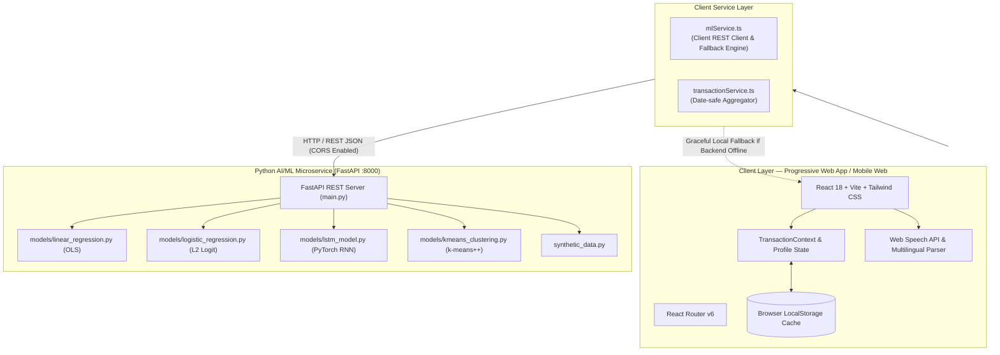

# 🏛️ Setu System Architecture & Application Modules

## 1. High-Level Architectural Blueprint

Setu employs a modern, decoupled 3-tier architecture optimized for responsiveness, offline resilience, and rapid ML experimentation:

---

## 2. Technology Stack Breakdown

| Layer | Technologies Used | Key Reason for Selection |
|---|---|---|
| **Frontend UI** | React 18, TypeScript, Tailwind CSS, Lucide React Icons | Component reusability, strict type-safety, rapid styling, responsive mobile-first ergonomics. |
| **Build & Bundler** | Vite 6 | Sub-second Hot Module Replacement (HMR) and optimized modern JavaScript bundling. |
| **Speech & NLU** | Web Speech API, Custom Indic Numeral Regex & Tokenizer | Zero-latency, browser-native voice capture; offline parsing of Hindi, Marathi, and Devanagari numerals. |
| **Backend Microservice** | Python 3.10+, FastAPI, Uvicorn, Pydantic | High-throughput asynchronous Python framework, automatic OpenAPI documentation, strict request validation. |
| **Machine Learning Core** | Scikit-learn 1.5.2, PyTorch 2.5.1, NumPy, Pandas | Industry standard for classical ML (regression, logistic, k-means) and deep learning recurrent architectures. |
| **Report Generation** | `python-docx`, Matplotlib, Seaborn | Programmatic compilation of official 30+ page university-standard Mini Project Report documents. |

---

## 3. Deep Dive into Frontend Application Modules

### 1. Landing & Onboarding (`LandingPage.tsx`, `OnboardingPage.tsx`)
* **Purpose:** Introduces the user to Setu in their preferred language (Hindi, Marathi, English) and collects baseline worker attributes:
  * Worker category (Delivery, Cab/Auto Driver, Construction, Domestic Work, Electrician, Plumber).
  * Primary working city (Pune, Mumbai, Delhi, Bengaluru, etc.).
  * Daily income expectation and monthly baseline budget target.
* **Storage:** Persisted in `localStorage` under `setu_user_profile`.

---

### 2. Home Dashboard (`HomePage.tsx`)
* **Purpose:** The centralized command centre for the gig worker's daily routine:
  * **Today's Earnings & Expenses:** Instant net balance card with high-contrast text and tactile "Add Income" / "Add Expense" buttons.
  * **Quick Voice Entry Button:** Floating microphone triggering the voice modal.
  * **Financial Health Meter:** Visual 0–100 gauge showing whether the worker is in the "Safe Zone", "Caution Zone", or "Deficit Risk".
  * **Active Gig Radar:** Glanceable summary of nearby high-paying jobs.
  * **Health & Rest Alert:** Active reminder showing continuous working hours and hydration/break advisories.

---

### 3. Dhan — Money & Financial Intelligence (`DhanPage.tsx`)
* **Purpose:** The core financial module of Setu. It bridges daily cash volatility with intelligent planning:
  * **Voice & Manual Transaction Modals:** Supports split income/expense tracking with tags (Fuel, Groceries, Bike Repair, Platform Payout, Cash Tip).
  * **Interactive Date Selector & Day View:**
    * Full calendar bar enabling workers to select any historical date or today.
    * Highlights dates with active income/expenses using visual dot indicators.
    * Displays day-specific breakdowns: Total Inflow, Total Outflow, Day Net, and itemized transaction cards with delete/edit options.
  * **Linear Regression Cash Flow Forecasting:**
    * Graphs historical 7-day balance against the model's 7-day projected forward trajectory.
    * Displays upper and lower 95% confidence intervals and predicted next-day net balance.
  * **Budget Overrun Early Warning (Logistic Regression):**
    * Computes real-time probability of running into a financial deficit.
    * Emits proactive alerts if the deficit probability exceeds 45%.
  * **Spending Persona Radar (K-Means):**
    * Discovers which cluster archetype the worker currently belongs to (e.g., *High Mileage Delivery Worker* vs. *Disciplined Saver*).

---

### 4. Kaam — Fair Work & Opportunity Marketplace (`KaamPage.tsx`)
* **Purpose:** Shields gig workers from opaque platforms and predatory intermediaries:
  * **Fair Pay Filter:** Displays opportunities verified to pay at or above regional minimum living wage benchmarks (e.g., ₹750/day in Pune/Mumbai).
  * **Semantic Job Matching:** Matches jobs based on the worker's verified skills, distance (km), and availability.
  * **No Commission Leakage:** Direct phone/WhatsApp connect with prospective clients or transparent platform listings.

---

### 5. Sehat — Health, Safety & Social Welfare (`SehatPage.tsx`)
* **Purpose:** Safeguards worker physical well-being and unlocks government welfare:
  * **Welfare Scheme Matcher:** Filters official central and state government schemes (e-Shram card benefits, Ayushman Bharat PM-JAY, PM-SVANidhi micro-credit).
  * **Rest & Fatigue Tracker:** Lets riders log hours on the road; generates restorative break notifications to prevent road accidents caused by algorithmic overwork.
  * **Emergency Helpline Speed Dials:** 112 (National Emergency), 108 (Ambulance), 1098, and gig worker unions.

---

### 6. Kaushal — Skill Passport & Portable Identity (`KaushalPage.tsx`)
* **Purpose:** Converts years of informal experience into recognized social capital:
  * **Dynamic Skill Extraction:** Extracts verified skills (e.g., "Two-Wheeler Navigation", "Residential Single-Phase Wiring", "App-Based Delivery Fleet Operations").
  * **Digital Skill Passport Card:** Downloadable and sharable identity card featuring worker photo, rating, verified jobs completed, and QR verification code.
  * **Micro-Upskilling Recommender:** Suggests 15-minute modular audio/video courses to help workers transition into higher-paying formal roles.

---

### 7. AI Lab — Interactive Model Testbench (`AiLabPage.tsx`)
* **Purpose:** A dedicated evaluation dashboard created for professors, academic reviewers, and ML engineers:
  * **Live Model Status:** Shows training state, framework versions (Scikit-Learn, PyTorch, FastAPI), and synthetic data generation indicators.
  * **Interactive Controls:**
    * Trigger re-training of Linear Regression, Logistic Regression, LSTM, or K-Means with custom transaction sample sizes.
    * Toggle between Synthetic Benchmark mode and User Transaction mode.
    * Inspect raw mathematical weights, coefficients, confusion matrices, and ROC-AUC curves.
