# 🗄️ Database Schema & Entity-Relationship (ER) Diagram

This document presents the complete relational and vector database architecture for **FairWork Setu**, including the visual ER diagram, entity specifications, indexing strategies, client-side offline storage, and privacy compliance.

---

## 1. Complete Entity-Relationship (ER) Diagram

```mermaid
erDiagram
    USERS ||--o{ INCOME_ENTRIES : "logs"
    USERS ||--o{ EXPENSE_ENTRIES : "incurs"
    USERS ||--o{ SAVINGS_GOALS : "targets"
    USERS ||--o{ USER_SKILLS : "possesses"
    USERS ||--o{ JOB_MATCHES : "receives"
    USERS ||--o{ VOICE_LOGS : "speaks"
    USERS ||--o{ SKILL_PASSPORTS : "owns"

    SKILLS ||--o{ USER_SKILLS : "categorizes"
    SKILLS ||--o{ JOB_SKILLS : "requires"

    JOBS ||--o{ JOB_SKILLS : "specifies"
    JOBS ||--o{ JOB_MATCHES : "matched_to"

    SCHEMES ||--o{ RAG_CHUNKS : "chunked_into"

    USERS {
        int id PK
        string phone_number UK "Unique Mobile ID"
        string name "Worker Full Name"
        string city "Base City"
        string preferred_language "hi / mr / en"
        string occupation "Primary Gig Category"
        int experience_years "Years in Trade"
        string availability "full_time / part_time"
        timestamp created_at
    }

    INCOME_ENTRIES {
        int id PK
        int user_id FK "References USERS(id)"
        decimal amount "Inflow in INR"
        string category "platform / cash / tip"
        string work_type "delivery / ride / trade"
        string source "voice / manual"
        date entry_date "Calendar Date"
        string notes "Indic transcript"
        timestamp created_at
    }

    EXPENSE_ENTRIES {
        int id PK
        int user_id FK "References USERS(id)"
        decimal amount "Outflow in INR"
        string category "fuel / food / rent / repair"
        date entry_date "Calendar Date"
        string notes "Expense Context"
        timestamp created_at
    }

    SAVINGS_GOALS {
        int id PK
        int user_id FK "References USERS(id)"
        string goal_name "e.g., Bike Insurance"
        decimal target_amount "Target in INR"
        decimal current_amount "Saved so far"
        date target_date
        string status "active / completed"
    }

    SKILLS {
        int id PK
        string name UK "e.g., Two-Wheeler Driving"
        string category "logistics / technical / domestic"
    }

    USER_SKILLS {
        int id PK
        int user_id FK "References USERS(id)"
        int skill_id FK "References SKILLS(id)"
        int experience_years
        string proficiency "beginner / skilled / master"
    }

    JOBS {
        int id PK
        string title "e.g., Express Delivery Partner"
        string employer_name "Platform or Contractor"
        string city
        decimal pay_min "Fair wage lower bound"
        decimal pay_max "Fair wage upper bound"
        string work_type "daily_wage / contract"
        boolean is_active
        timestamp created_at
    }

    JOB_SKILLS {
        int id PK
        int job_id FK "References JOBS(id)"
        int skill_id FK "References SKILLS(id)"
        boolean is_required
    }

    JOB_MATCHES {
        int id PK
        int user_id FK "References USERS(id)"
        int job_id FK "References JOBS(id)"
        decimal match_score "Cosine similarity 0-1"
        decimal distance_km "Commute distance"
        string status "suggested / applied"
        timestamp created_at
    }

    SCHEMES {
        int id PK
        string scheme_id UK "e.g., E_SHRAM_01"
        string title "e.g., Ayushman Bharat PM-JAY"
        string category "insurance / pension / loan"
        text eligibility "Eligibility criteria text"
        text benefits "Benefits description"
        string source_url "Official Portal"
    }

    RAG_CHUNKS {
        int id PK
        string source_type "scheme / health_faq"
        int source_id "References SCHEMES(id)"
        string title
        text content "Text passage"
        vector embedding "384-dimensional dense vector"
    }

    VOICE_LOGS {
        int id PK
        int user_id FK "References USERS(id)"
        string detected_language "hi-IN / mr-IN"
        string transcript "Raw spoken text"
        string intent "income / expense / query"
        jsonb extracted_data "Parsed JSON payload"
        int processing_time_ms
        timestamp created_at
    }

    SKILL_PASSPORTS {
        int id PK
        int user_id FK "References USERS(id)"
        string pdf_url "Downloadable link"
        jsonb summary "Aggregated badges & metrics"
        timestamp generated_at
    }
```



---

## 2. Table-by-Table Data Dictionary

### Core User & Identity
| Table | Description | Primary Key | Foreign Keys |
|---|---|---|---|
| `users` | Stores gig worker profiles, contact numbers, primary trade, and preferred vernacular language. | `id (SERIAL)` | None |
| `skills` | Master taxonomy of informal trades and skills (e.g., "Food Delivery Navigation", "AC Servicing"). | `id (SERIAL)` | None |
| `user_skills` | Associative table mapping workers to their verified proficiencies and experience. | `id (SERIAL)` | `user_id` $\rightarrow$ `users(id)`, `skill_id` $\rightarrow$ `skills(id)` |

### Financial Ledger & ML Data Source
| Table | Description | Primary Key | Foreign Keys |
|---|---|---|---|
| `income_entries` | Inflows recorded via voice or manual entry (Platform payouts, cash payments, customer tips). Feeds directly into Linear Regression and LSTM pipelines. | `id (SERIAL)` | `user_id` $\rightarrow$ `users(id)` |
| `expense_entries` | Outflows tagged by category (Fuel, Food, Vehicle Repairs, Rent, Healthcare). Feeds into K-Means clustering and Logistic Regression risk models. | `id (SERIAL)` | `user_id` $\rightarrow$ `users(id)` |
| `savings_goals` | Micro-savings targets (Festival funds, insurance premiums, vehicle down payments). | `id (SERIAL)` | `user_id` $\rightarrow$ `users(id)` |

### Work & Gig Opportunities
| Table | Description | Primary Key | Foreign Keys |
|---|---|---|---|
| `jobs` | Curated gig listings adhering to fair wage benchmarks ($\ge ₹750/\text{day}$). | `id (SERIAL)` | None |
| `job_skills` | Many-to-many relationship linking required skills to specific jobs. | `id (SERIAL)` | `job_id` $\rightarrow$ `jobs(id)`, `skill_id` $\rightarrow$ `skills(id)` |
| `job_matches` | Recommendation engine output storing semantic similarity match scores and distance. | `id (SERIAL)` | `user_id` $\rightarrow$ `users(id)`, `job_id` $\rightarrow$ `jobs(id)` |

### Social Security & Health RAG
| Table | Description | Primary Key | Foreign Keys |
|---|---|---|---|
| `schemes` | Central & state government social safety schemes (e-Shram, PM-JAY, BOCW). | `id (SERIAL)` | None |
| `rag_chunks` | Document chunks embedded with 384-dimensional Sentence Transformers for semantic similarity search. | `id (SERIAL)` | `source_id` $\rightarrow$ `schemes(id)` |

### Voice Audit & Verifiable Credentialing
| Table | Description | Primary Key | Foreign Keys |
|---|---|---|---|
| `voice_logs` | Audit record of audio inputs, transcriptions, detected intent, and processing latency. | `id (SERIAL)` | `user_id` $\rightarrow$ `users(id)` |
| `skill_passports` | Digital credential snapshots with verified badges, ratings, and QR code payload. | `id (SERIAL)` | `user_id` $\rightarrow$ `users(id)` |

---

## 3. Client-Side Offline Storage Schema (Browser LocalStorage)

To guarantee uninterrupted operation in low-connectivity environments (such as highway transit, delivery basements, and construction sites), the client application maintains a synchronized local cache:

```json
{
  "setu_user_profile": {
    "name": "Ramesh Kumar",
    "phone": "+91 98765 43210",
    "occupation": "Delivery Partner",
    "city": "Pune",
    "preferredLanguage": "hi",
    "dailyTarget": 800,
    "monthlyBudget": 18000
  },
  "setu_transactions_v1": [
    {
      "id": "tx-1712901234567",
      "type": "income",
      "amount": 750,
      "category": "delivery",
      "description": "Swiggy order payout",
      "timestamp": "2026-10-12T09:30:00+05:30",
      "source": "voice"
    },
    {
      "id": "tx-1712901456789",
      "type": "expense",
      "amount": 150,
      "category": "fuel",
      "description": "Petrol refill",
      "timestamp": "2026-10-12T11:15:00+05:30",
      "source": "manual"
    }
  ],
  "setu_app_language": "hi"
}
```

* **Storage Engine:** Standard HTML5 `localStorage` with JSON serialization.
* **Sync Policy:** Every new voice or manual transaction writes atomically to local storage first, then attempts asynchronous synchronization with the backend API.
* **Timezone Safety:** All ISO timestamps preserve local Indian Standard Time (`+05:30`) to avoid calendar day-boundary drift.

---

## 4. Indexing & Query Optimization

To maintain sub-50ms API response times on high-volume financial queries, the following PostgreSQL indexes are applied:

```sql
-- 1. Fast chronological lookups for Dhan screen time-series charts
CREATE INDEX idx_income_user_date ON income_entries(user_id, entry_date DESC);
CREATE INDEX idx_expense_user_date ON expense_entries(user_id, entry_date DESC);

-- 2. Spatial & active status filters for nearby gig matching
CREATE INDEX idx_jobs_city_active ON jobs(city, is_active) WHERE is_active = TRUE;

-- 3. Composite index for user job recommendations
CREATE INDEX idx_job_matches_user_score ON job_matches(user_id, match_score DESC);

-- 4. HNSW Vector Index for fast semantic retrieval in Sehat RAG
CREATE INDEX idx_rag_chunks_hnsw ON rag_chunks USING hnsw (embedding vector_cosine_ops)
WITH (m = 16, ef_construction = 64);
```

---

## 5. Privacy, Ethics & Data Protection (DPDP Act Compliance)

1. **Principle of Data Minimization:** We store only fields essential for livelihood tracking (no Aadhaar numbers, biometric data, or permanent bank account passwords).
2. **Short-Lived Audio Buffering:** Spoken audio streams are transcribed on the fly; raw audio waveforms are discarded immediately after transcription to preserve worker voice privacy.
3. **Right to Forgotten / Erasure:** Cascading foreign keys (`ON DELETE CASCADE`) guarantee that if a worker requests account deletion, all associated ledgers, skills, and match logs are permanently purged in a single transaction.
4. **Non-Predatory Use:** Stored ledger data is protected against commercial third-party sale to predatory payday loan lenders.
