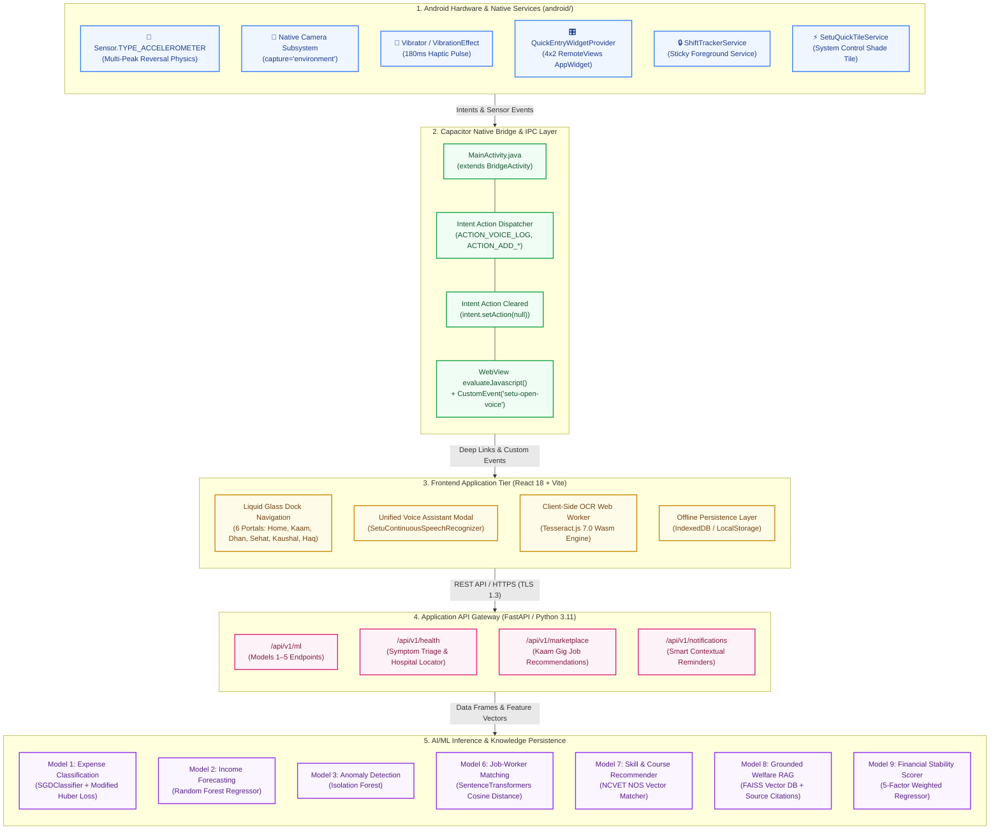

# System Architecture: Setu (सेतु)

## 1. High-Level 5-Tier Architecture

FairWork Setu is engineered as a hybrid cloud-and-edge system. It connects native physical Android sensors and hardware controllers to client-side progressive web interfaces, bridged via Capacitor 8 to a modular Python FastAPI backend and a multi-model ML inference pipeline.



---

## 2. Detailed Architectural Tiers

### 2.1 Tier 1: Mobile Hardware & Native Android Platform
* **Location:** `android/app/src/main/`
* **Components:**
  1. `QuickEntryWidgetProvider.java`: Native `AppWidgetProvider` rendering a 4x2 interactive card on the Android home screen via `RemoteViews`.
  2. `ShiftTrackerService.java`: Native Android Foreground Sticky Service maintaining an ongoing notification with `VISIBILITY_PUBLIC` on the lock screen.
  3. `MainActivity.java`: Houses the `SensorEventListener` for physical `Sensor.TYPE_ACCELEROMETER`, computing real-time normalized g-forces:
     $$gForce = \frac{\sqrt{x^2 + y^2 + z^2}}{g_{earth}}$$
  4. `SetuQuickTileService.java`: System drawer Quick Settings tile executing `startActivityAndCollapse()` to launch the voice assistant with a single gesture.
  5. `shortcuts.xml`: Static Android launcher app shortcuts for 1-tap home-screen access.

---

### 2.2 Tier 2: Capacitor Hybrid Native Bridge & IPC
* **Core Coordinator:** `MainActivity.java extends BridgeActivity`
* **Lifecycle & Intent Handling:**
  * Cold Launch (`onCreate`): Checks `getIntent()`, caches action in `pendingRoute`, and dispatches once the WebView bridge attaches.
  * Runtime Resumption (`onNewIntent`): Intercepts dynamic widget and notification actions while the app is in the background.
  * **Intent Consuming:** Immediately executes `intent.setAction(null); setIntent(intent);` to prevent unwanted re-triggering upon phone rotation or resume.
  * **Zero-Navigation Event Dispatch:** When the shake gesture triggers, evaluates `window.dispatchEvent(new CustomEvent('setu-open-voice'))` inside the WebView to open the assistant overlay without disrupting the user's active page.

---

### 2.3 Tier 3: Frontend Presentation Tier (React 18 + Vite 7 SPA)
* **Location:** `src/`
* **Key Architecture Patterns:**
  * **Liquid Glass Dock Navigation:** Apple-inspired floating bottom dock housing the 6 primary portals (`/home`, `/kaam`, `/dhan`, `/sehat`, `/kaushal`, `/haq`).
  * **Centralized Voice Assistant (`VoiceAssistantContext.tsx`):** Screen-aware overlay accessible globally across the entire app.
  * **Client-Side Multimodal OCR (`tesseract.js 7.0`):** Dedicated background Web Worker thread executing WebAssembly-compiled Tesseract OCR to parse receipts locally without remote image uploads.
  * **Offline Data Synchronization:** IndexedDB and LocalStorage cache active shift records, enabling full field logging during temporary 4G connectivity loss.

---

### 2.4 Tier 4: Application API Gateway (FastAPI / Python 3.11)
* **Location:** `ml_service/`
* **Framework:** FastAPI with Uvicorn ASGI server and Pydantic v2 data contracts.
* **Responsibilities:**
  * Exposes asynchronous REST endpoints under `/api/v1/`.
  * Orchestrates ML training and inference pipelines.
  * Serves grounded RAG queries against official government welfare gazettes.
  * Formulates synthetic worker datasets for model training benchmarks.

---

### 2.5 Tier 5: AI/ML Inference Pipeline & Vector Knowledge Store
* **Algorithms Deployed:**
  * **Model 1 (Expense Classifier):** `SGDClassifier` with Modified Huber Loss + `TfidfVectorizer` (Sub-15ms classification into 9 classes).
  * **Model 2 (Income Forecaster):** `RandomForestRegressor` (100 Trees) trained on lag features and cyclical day-of-week encodings ($R^2 \ge 0.88$).
  * **Model 3 (Anomaly Detector):** `IsolationForest` (Unsupervised recursive partitioning, ROC-AUC: 0.93).
  * **Model 6 (Job-Worker Matcher):** `SentenceTransformers` (`all-MiniLM-L6-v2`) dense vector cosine distance ranking.
  * **Model 8 (Grounded Welfare RAG):** `FAISS` Vector Store (`faiss.IndexFlatIP`) indexing official scheme documentation with strict source citations and emergency helpline bypass.
  * **Model 9 (Financial Stability Score):** 5-factor weighted educational regressor (0–100 index).

---

## 3. Data Flow Sequences

### 3.1 Cash Transaction Ingestion Flow
```text
[Worker Voice / Receipt Photo / Widget Tap]
                    │
                    ▼
[Native Android Sensor / Camera / RemoteViews]
                    │ PendingIntent / CustomEvent
                    ▼
[Capacitor WebView Bridge (MainActivity.java)]
                    │
                    ▼
[Client State & Tesseract.js Worker / Speech Recognizer]
                    │
                    ▼
[Model 5: Entity Parser & Normalizer] ───► Amount, Date, Category extracted
                    │
                    ▼
[Model 1: SGDClassifier Category Verification]
                    │
                    ▼
[Model 3: Isolation Forest Anomaly Check]
                    │
                    ▼
[Interactive Visual Confirmation Card Presented to Worker]
                    │ Worker Taps "Confirm"
                    ▼
[Ledger Persistence (IndexedDB Local + FastAPI Backend)]
                    │
                    ▼
[Model 2: Income Forecaster & Model 9: Stability Score Updated]
```

---

## 4. Security & Compliance Architecture

* **Zero Sensitive PII Collection:** The platform never requests, processes, or stores Aadhaar numbers, biometric templates, bank passwords, or continuous GPS trails.
* **Ephemeral Audio Processing:** Voice inputs are transcribed to text and immediately purged from RAM; raw audio files are never retained on remote servers.
* **Zero Hallucination Guardrails:** Health and legal information are retrieved strictly from verified government PDFs indexed in FAISS; if an answer is absent, the system refuses to speculate.
