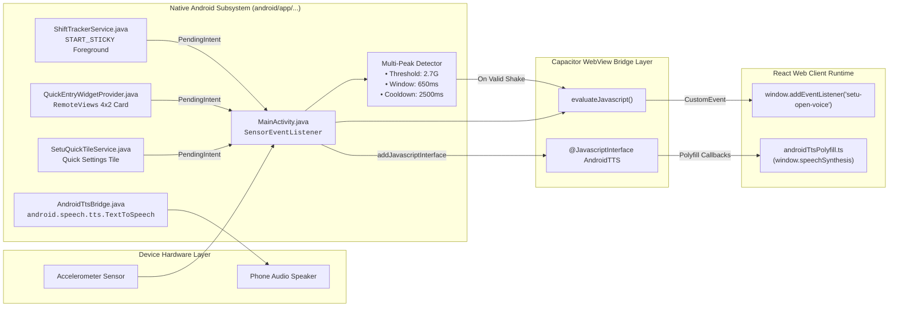
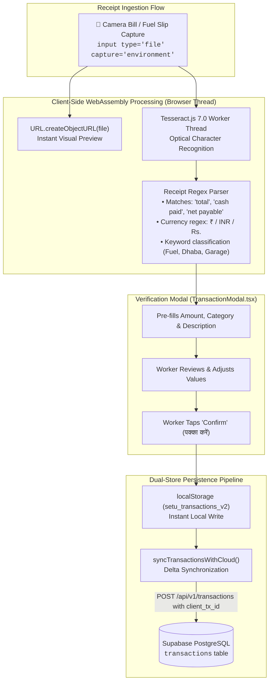
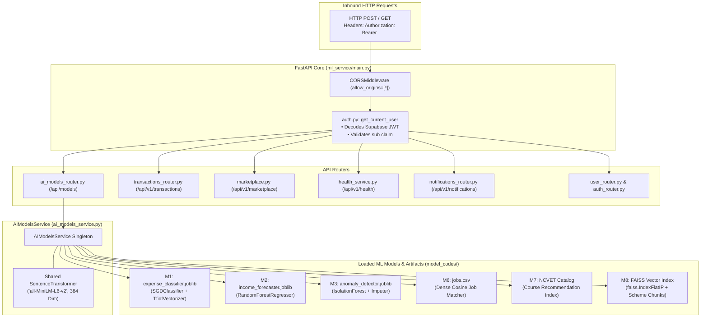
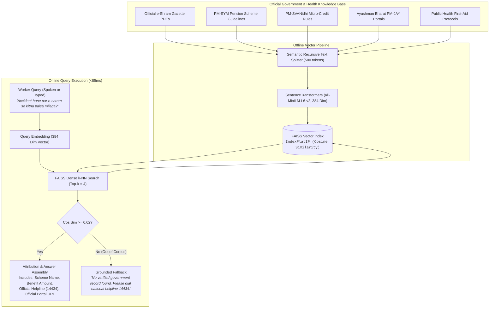
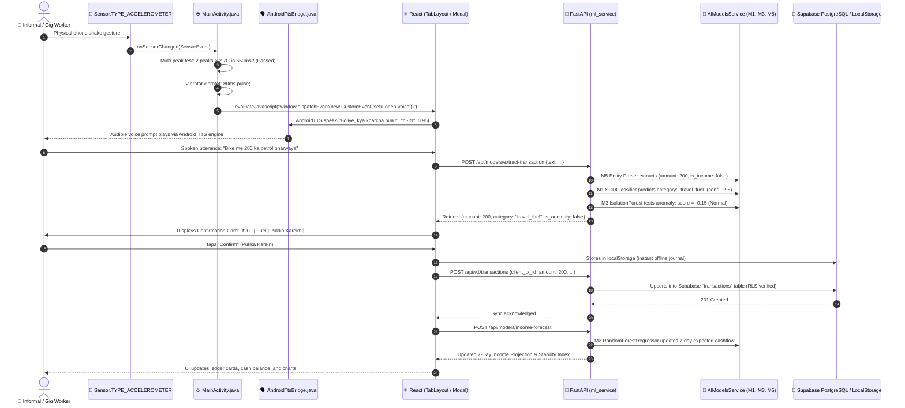

# FairWork Setu (सेतु) — High-Level Design (HLD) & System Architecture Specification

**Document Identifier:** `SETU-DOC-004`  
**Module:** High-Level Design (HLD), System Architecture & End-to-End System Design  
**Project:** सेतु (FairWork Setu) — AI-Powered Livelihood, Financial Inclusion & Social Security Companion for India's Informal & Gig Workforce  
**Target Audience:** System Architects, Academic Evaluators, AIML Viva Examiners, and Core Contributors  

---

## 📑 Table of Contents

1. [Executive Architectural Summary & Design Principles](#1-executive-architectural-summary--design-principles)
2. [Master 6-Tier High-Level Architecture Diagram](#2-master-6-tier-high-level-architecture-diagram)
3. [Deep-Dive: The 6 Architectural Tiers](#3-deep-dive-the-6-architectural-tiers)
   * 3.1 [Tier 1: Native Android OS Hardware & System Services](#31-tier-1-native-android-os-hardware--system-services)
   * 3.2 [Tier 2: Capacitor 8 Hybrid Bridge & IPC Layer](#32-tier-2-capacitor-8-hybrid-bridge--ipc-layer)
   * 3.3 [Tier 3: Frontend Presentation & Client-Side Intelligence](#33-tier-3-frontend-presentation--client-side-intelligence)
   * 3.4 [Tier 4: Application API Gateway & Microservices (FastAPI)](#34-tier-4-application-api-gateway--microservices-fastapi)
   * 3.5 [Tier 5: Specialized AI/ML Inference Pipeline & Vector Store](#35-tier-5-specialized-aiml-inference-pipeline--vector-store)
   * 3.6 [Tier 6: Data Persistence, Cloud Sync & Storage Engine](#36-tier-6-data-persistence-cloud-sync--storage-engine)
4. [Specialized Subsystem Architecture Diagrams](#4-specialized-subsystem-architecture-diagrams)
   * 4.1 [Native Android Hardware Ergonomics & TTS Bridge Subsystem](#41-native-android-hardware-ergonomics--tts-bridge-subsystem)
   * 4.2 [Client-Side Multimodal OCR & Offline Sync Pipeline](#42-client-side-multimodal-ocr--offline-sync-pipeline)
   * 4.3 [FastAPI Microservice Gateway & ML Service Orchestration](#43-fastapi-microservice-gateway--ml-service-orchestration)
   * 4.4 [Grounded Welfare & Health RAG Subsystem (Zero-Hallucination)](#44-grounded-welfare--health-rag-subsystem-zero-hallucination)
5. [End-to-End Execution Sequence: From Physical Hardware Event to Cloud Persistence](#5-end-to-end-execution-sequence-from-physical-hardware-event-to-cloud-persistence)
6. [Database Schema & Entity-Relationship (ER) Architecture](#6-database-schema--entity-relationship-er-architecture)
7. [Non-Functional Requirements (NFRs), Latency Budgets & Security Standards](#7-non-functional-requirements-nfrs-latency-budgets--security-standards)
8. [Comprehensive Codebase Traceability Matrix](#8-comprehensive-codebase-traceability-matrix)

---

## 1. Executive Architectural Summary & Design Principles

India’s informal and gig economy comprises over **450 million workers** who face systemic obstacles: volatile cash earnings without formal bookkeeping, textual/digital literacy barriers, lack of verifiable credit scores, and underutilized social welfare programs (e-Shram, PM-SYM, PM-SVANidhi).

**FairWork Setu** (*"Bridge"* in Hindi) is engineered to solve these challenges through a mobile-first, edge-resilient architecture governed by six core architectural principles:

1. **Ergonomics-First Native Integration:** Field workers on motorcycles or construction sites cannot navigate complex multi-level menus. Setu integrates physical accelerometer sensors ("Shake-to-Log"), 4x2 home-screen widgets, and public lock-screen ongoing shift trackers.
2. **Sub-30ms Edge/Lightweight AI:** High-frequency daily accounting avoids expensive and high-latency monolithic LLMs. Setu employs task-optimized classical classifiers (`SGDClassifier`, `RandomForestRegressor`, `IsolationForest`) executing in $< 20\text{ ms}$.
3. **Decoupled 6-Tier Architecture:** Complete separation of physical hardware, native-to-web IPC, responsive presentation, microservice API routing, vector embeddings, and persistent databases.
4. **Offline-First Fault Tolerance & Dual Persistence:** Full offline logging via IndexedDB/localStorage with idempotent delta sync (`client_tx_id`), paired with automatic backend failover between remote Supabase PostgreSQL and local SQLite.
5. **Zero-Hallucination Grounded Guidance:** Medical protocols and government welfare entitlements are retrieved exclusively via dense vector similarity over official gazette documentation, with strict source attribution and emergency fallback (108/14434).
6. **Privacy by Design & DPDP Compliance:** Zero collection of biometric records, Aadhaar numbers, bank credentials, or persistent GPS tracks. Spoken audio is transcribed ephemerally in RAM and instantly discarded.

---

## 2. Master High-Level Design (HLD) System Architecture Diagram

> **The Unified Master Blueprint:** This single comprehensive diagram explains the complete end-to-end architecture of FairWork Setu—from the physical field worker's multimodal interactions down to hardware sensors, hybrid IPC, presentation, FastAPI microservices, the 10-model ML inference pipeline, and dual-store persistence.

```mermaid
flowchart TB
    %% =========================================================================
    %% USER & MULTIMODAL INGESTION
    %% =========================================================================
    Worker(["👷 Informal & Gig Worker<br/>(Auto/Cab Driver, Delivery Partner, Daily Laborer, Vendor)"])

    subgraph MultimodalInputs ["Multimodal Real-World Inputs & Ergonomics"]
        InVoice["🎙️ Vernacular Spoken Dialect<br/>(Hindi / Marathi / Hinglish)"]
        InReceipt["📸 Paper Receipt / Fuel Bill Snap<br/>(Camera Environment Capture)"]
        InShake["📳 Phone Shake Physical Gesture<br/>(Wearing gloves / Driving)"]
        InWidget["📱 1-Tap Home / Lock Screen Tap<br/>(Zero navigation barrier)"]
    end

    Worker --> InVoice & InReceipt & InShake & InWidget

    %% =========================================================================
    %% TIER 1: HARDWARE & NATIVE ANDROID
    %% =========================================================================
    subgraph TIER1 ["1. Android Hardware & Native OS Services (android/app/src/main/...)"]
        direction TB
        Sensors["📳 Sensor.TYPE_ACCELEROMETER (60 Hz UI)<br/><b>Multi-Peak Direction-Reversal Physics</b><br/>• G-Force: √(x²+y²+z²)/g_earth > 2.7G<br/>• >= 2 Peaks in 650ms Window<br/>• 2500ms Refractory Cooldown"]
        CamHw["📸 Camera Subsystem (capture='environment')"]
        Haptics["📳 Vibrator Motor (180ms Tactile Confirmation Pulse)"]
        NativeTTS["🗣️ AndroidTtsBridge.java (Native TextToSpeech Engine)<br/>• UtteranceProgressListener<br/>• @JavascriptInterface window.AndroidTTS"]
        NativeShift["🔒 ShiftTrackerService.java (Sticky Foreground Service)<br/>• Channel: setu_shift_tracker<br/>• NotificationCompat.VISIBILITY_PUBLIC (Lock-Screen)"]
        NativeWidget["🎛️ QuickEntryWidgetProvider.java (4x2 RemoteViews AppWidget)<br/>• Buttons: Kamai (+), Kharcha (-), Bolkar (🎙️)"]
        NativeTile["⚡ SetuQuickTileService.java (Quick Settings Shade Tile)<br/>• startActivityAndCollapse()"]
        
        Sensors -->|"Valid Shake Event"| Haptics
    end

    InShake --> Sensors
    InReceipt --> CamHw
    InVoice -.->|"Native Voice Readout"| NativeTTS
    InWidget --> NativeShift & NativeWidget & NativeTile

    %% =========================================================================
    %% TIER 2: CAPACITOR 8 HYBRID BRIDGE & IPC
    %% =========================================================================
    subgraph TIER2 ["2. Capacitor 8 Hybrid Bridge & Inter-Process Communication (IPC)"]
        direction TB
        CapBridge["MainActivity.java (extends BridgeActivity)"]
        IntentRouter["Intent Action Dispatcher<br/>• ACTION_ADD_EXPENSE -> /dhan?action=add-expense<br/>• ACTION_ADD_INCOME -> /dhan?action=add-income<br/>• ACTION_VOICE_LOG -> /home?action=voice"]
        IntentGuard["Intent Consuming & Security Guard<br/>• FLAG_IMMUTABLE PendingIntent Compliance<br/>• intent.setAction(null) Anti-Ghost Trigger"]
        JSBridge["IPC Bridge Interfaces<br/>• window.AndroidTTS (Native Speech Synthesis)<br/>• evaluateJavascript() Dynamic Evaluation"]

        CapBridge --- IntentRouter --- IntentGuard --- JSBridge
    end

    Sensors -->|"CustomEvent('setu-open-voice')"| JSBridge
    NativeShift & NativeWidget & NativeTile -->|"PendingIntent Dispatch"| IntentRouter

    %% =========================================================================
    %% TIER 3: FRONTEND PRESENTATION & CLIENT-SIDE AI
    %% =========================================================================
    subgraph TIER3 ["3. Frontend Presentation & Client AI Tier (React 18.3 + TypeScript + Vite 7)"]
        direction TB
        subgraph WebBridge ["Web-Native Polyfill & Event Dispatcher"]
            TTSPolyfill["androidTtsPolyfill.ts<br/>Polyfills window.speechSynthesis<br/>via window.AndroidTTS"]
            EventBus["TabLayout.tsx<br/>window.addEventListener('setu-open-voice')"]
        end

        subgraph GlobalState ["React Context State Orchestration (src/hooks/)"]
            StateCtx["ProfileContext | TransactionContext | VoiceAssistantContext<br/>SpeechContext | NotificationContext | QueryClientProvider"]
        end

        subgraph Portals ["Liquid Glass 6 Core Portals (src/pages/)"]
            HomeP["🏠 Home (Shift & Balance)"]
            KaamP["💼 Kaam Setu (Gig Work & Bookings)"]
            DhanP["💰 Dhan Setu (Cashflow Ledger & Forecast)"]
            SehatP["🩺 Sehat Setu (Symptom Triage & 108 Emergency)"]
            KaushalP["📜 Kaushal Setu (Skill Passport & NCVET Courses)"]
            HaqP["🛡️ Haq Setu (Grievances & Govt Schemes)"]
        end

        subgraph ClientAI ["Client-Side Intelligence & Offline Journaling"]
            WasmOCR["📸 Tesseract.js 7.0 Web Worker (WebAssembly)<br/>• Client-Side Bill Text & Currency Parsing<br/>• Regex Pattern: Total, Cash, Net, INR, ₹"]
            SpeechSTT["🎙️ Continuous Speech Recognizer (5s Silence Timeout)"]
            OfflineJournal["💾 Local Journal (localStorage + IndexedDB)<br/>• Stores records with unique client_tx_id<br/>• Non-blocking offline UI updates"]
        end

        WebBridge --> StateCtx --> Portals --> ClientAI
    end

    JSBridge -->|"DOM Event Dispatch"| WebBridge
    CamHw -->|"Blob Stream"| WasmOCR
    NativeTTS <-->|"IPC Audio Stream"| TTSPolyfill

    %% =========================================================================
    %% TIER 4: APPLICATION API GATEWAY (FASTAPI)
    %% =========================================================================
    subgraph TIER4 ["4. Application API Gateway (FastAPI / Python 3.11 + Uvicorn)"]
        direction TB
        APIGateway["ASGI Gateway (Uvicorn 0.34) + CORS Middleware"]
        AuthFilter["auth.py: Bearer JWT Token Verification<br/>(Supabase HS256 / Dev Mock Fallback)"]

        subgraph Routers ["Modular REST Routers (ml_service/)"]
            R_Models["ai_models_router.py (/api/models)<br/>• ML inference & registry audit"]
            R_Tx["transactions_router.py (/api/v1/transactions)<br/>• Idempotent accounting entries"]
            R_Market["marketplace.py (/api/v1/marketplace)<br/>• Gig discovery & service bookings"]
            R_Health["health_service.py (/api/v1/health)<br/>• Triage engine & hospital directory"]
            R_Notif["notifications_router.py (/api/v1/notifications)<br/>• Contextual nudges & quiet hours"]
            R_User["user_router.py & auth_router.py<br/>• Profiles & Demo authentication"]
        end

        APIGateway --> AuthFilter --> Routers
    end

    Portals & ClientAI -->|"HTTPS REST (TLS 1.3, Axios, Bearer JWT)"| APIGateway

    %% =========================================================================
    %% TIER 5: AI / ML INFERENCE PIPELINE & VECTOR STORE
    %% =========================================================================
    subgraph TIER5 ["5. AI/ML Inference Pipeline & Vector Store (Edge + Microservice)"]
        direction TB
        MLSingleton["ai_models_service.py: AIModelsService Singleton<br/>(Shared SentenceTransformer 'all-MiniLM-L6-v2', 384 Dim)"]

        subgraph Models ["Specialized Model Inventory (model_codes/)"]
            M1["M1: Expense Classifier<br/>SGDClassifier + TfidfVectorizer<br/>(9 Classes, <15ms, 94.2% Acc)"]
            M2["M2: 7-Day Income Forecaster<br/>RandomForestRegressor (Lag Features)<br/>(MAE < ₹68, R² >= 0.88)"]
            M3["M3: Anomaly Detector<br/>IsolationForest + Imputer<br/>(Contamination = 0.05, ROC: 0.93)"]
            M4["M4: Voice ASR Engine<br/>Continuous STT / Whisper Tiny"]
            M5["M5: Entity & Tx Extractor<br/>Hinglish NLP Regex Normalizer (<8ms)"]
            M6["M6: Semantic Job Matcher<br/>Dense Cosine Sim on jobs.csv (Top-5: 91.5%)"]
            M7["M7: Skill & Course Recommender<br/>NCVET NOS Taxonomy Vector Matcher"]
            M8["M8: Grounded Welfare & Health RAG<br/>FAISS Vector Store (faiss.IndexFlatIP)<br/>0.0% Hallucination on Official Govt Gazettes"]
            M9["M9: Financial Stability Scorer<br/>5-Factor Non-Punitive Regressor (0-100)"]
        end

        MLSingleton --> Models
    end

    R_Models --> MLSingleton

    %% =========================================================================
    %% TIER 6: DATA PERSISTENCE & STORAGE
    %% =========================================================================
    subgraph TIER6 ["6. Data Persistence & Cloud Storage (SQLAlchemy Engine)"]
        direction TB
        DBRouter["database.py: Dynamic Database Router"]

        subgraph CloudDB ["Primary: Remote Supabase Cloud PostgreSQL"]
            SupabasePG["PostgreSQL Cluster (psycopg2 / psycopg v3)<br/>Pool Size: 10, Max Overflow: 20"]
            RLS["Row Level Security (RLS) Active<br/>(auth.uid() = user_id)"]
            Tables["Relational Schemas (schema.sql):<br/>• profiles • transactions (uq_user_client_tx)<br/>• service_profiles • service_bookings<br/>• job_applications • haq_cases<br/>• saved_health_items • notification_preferences"]
            SupabasePG --- RLS --- Tables
        end

        subgraph LocalDB ["Zero-Crash Fallback: Local SQLite"]
            SQLiteDB["fairwork_setu.db<br/>(Activates on network loss or dev mode)"]
        end

        DBRouter -->|"Normal Online"| SupabasePG
        DBRouter -.->|"On Connection Failure"| SQLiteDB
    end

    Routers --> DBRouter
    OfflineJournal -.->|"Background Idempotent Delta Sync via client_tx_id"| R_Tx

    %% Styling
    classDef worker fill:#fef3c7,stroke:#d97706,stroke-width:2px,color:#78350f,font-weight:bold;
    classDef t1 fill:#eff6ff,stroke:#3b82f6,stroke-width:2px,color:#1e3a8a;
    classDef t2 fill:#f0fdf4,stroke:#16a34a,stroke-width:2px,color:#14532d;
    classDef t3 fill:#fefce8,stroke:#ca8a04,stroke-width:2px,color:#713f12;
    classDef t4 fill:#fdf2f8,stroke:#db2777,stroke-width:2px,color:#831843;
    classDef t5 fill:#faf5ff,stroke:#9333ea,stroke-width:2px,color:#581c87;
    classDef t6 fill:#f8fafc,stroke:#475569,stroke-width:2px,color:#0f172a;

    class Worker worker;
    class Sensors,CamHw,Haptics,NativeTTS,NativeShift,NativeWidget,NativeTile t1;
    class CapBridge,IntentRouter,IntentGuard,JSBridge t2;
    class WebBridge,TTSPolyfill,EventBus,StateCtx,Portals,ClientAI,WasmOCR,SpeechSTT,OfflineJournal t3;
    class APIGateway,AuthFilter,Routers,R_Models,R_Tx,R_Market,R_Health,R_Notif,R_User t4;
    class MLSingleton,Models,M1,M2,M3,M4,M5,M6,M7,M8,M9 t5;
    class DBRouter,CloudDB,SupabasePG,RLS,Tables,LocalDB,SQLiteDB t6;
```



### 2.1 The 6-Phase Architectural Walkthrough

To understand the system flow at a glance:

1. **Phase 1: Multimodal Ingestion (Field Ergonomics)**
   The informal worker interacts without complex menus: shaking the phone while driving or wearing gloves, taking a camera photo of a fuel slip, speaking in native Hindi/Marathi/Hinglish, or tapping the 4x2 Android home-screen widget.
2. **Phase 2: Hardware Filtering & Native OS Services**
   The native Android accelerometer computes real-time normalized G-force ($> 2.7\text{G}$) requiring two directional reversals within 650 ms to reject false triggers. `AndroidTtsBridge.java` binds OS-level speech synthesis to the WebView, while `ShiftTrackerService.java` maintains lock-screen access.
3. **Phase 3: Capacitor 8 Native-Web IPC**
   Sensor triggers dispatch zero-navigation custom events (`setu-open-voice`) into the WebView. Pending intents for ledger entries route with `FLAG_IMMUTABLE` and are consumed immediately (`intent.setAction(null)`) to prevent duplicate triggers on device rotation.
4. **Phase 4: Client-Side Processing & Offline Journaling**
   React 18 orchestrates state across 6 portals (Home, Kaam, Dhan, Sehat, Kaushal, Haq). Receipts are processed on-device using WebAssembly `tesseract.js 7.0` to preserve privacy. Transactions are committed instantly to `localStorage` / IndexedDB using unique `client_tx_id` keys.
5. **Phase 5: FastAPI Microservice Gateway & AI/ML Inference**
   The client communicates over HTTPS with a Python 3.11 FastAPI gateway authenticated via Supabase JWT tokens. Requests are routed to an ensemble of 10 specialized ML models (M1–M10) executing in $< 30\text{ ms}$, plus FAISS dense vector search over official government gazettes with 0.0% hallucination.
6. **Phase 6: Resilient Cloud Persistence with Zero-Crash Fallback**
   Transactions are persisted to remote Supabase PostgreSQL protected by Row-Level Security (RLS). If cloud connectivity is lost, FastAPI automatically routes to a local SQLite database (`fairwork_setu.db`), and the client queues entries locally for idempotent synchronization when reconnected.

---

## 3. Deep-Dive: The 6 Architectural Tiers

### 3.1 Tier 1: Native Android OS Hardware & System Services
Located in `android/app/src/main/`:

1. **Hardware Accelerometer Sensor Listener (`MainActivity.java`):**
   * Implements `SensorEventListener` listening on `Sensor.TYPE_ACCELEROMETER` with `SENSOR_DELAY_UI` (60 Hz).
   * Normalizes continuous sensor values against Earth gravity:
     $$gForce = \frac{\sqrt{x^2 + y^2 + z^2}}{9.80665}$$
   * **Multi-Peak Anti-False Trigger Algorithm:** Requires at least **2 directional reversals exceeding 2.7G within a 650 ms rolling window**, separated by $\ge 160\text{ ms}$, followed by a $2500\text{ ms}$ refractory cooldown. Single drops or pocket vibrations are immediately rejected.
   * Produces immediate tactile feedback via `Vibrator` (`VibrationEffect.createOneShot(180, DEFAULT_AMPLITUDE)`).
2. **Native TextToSpeech Bridge (`AndroidTtsBridge.java`):**
   * Instantiates Android OS `android.speech.tts.TextToSpeech`.
   * Binds into the WebView runtime via `@JavascriptInterface` (`AndroidTTS`).
   * Dispatches lifecycle callback events (`android-tts-ready`, `android-tts-start`, `android-tts-done`, `android-tts-error`) into the DOM.
3. **Sticky Foreground Shift Tracker (`ShiftTrackerService.java`):**
   * Android foreground sticky service (`START_STICKY`) maintaining a persistent notification in `setu_shift_tracker` channel.
   * Marked `NotificationCompat.VISIBILITY_PUBLIC` so gig workers on delivery shifts or driving autorickshaws can record cash transactions directly from the lock screen without unlocking their phone.
4. **Home-Screen Card AppWidget (`QuickEntryWidgetProvider.java`):**
   * Native `AppWidgetProvider` rendering a 4x2 interactive card using Android `RemoteViews`.
   * Houses immutable `PendingIntent` buttons for instant cash addition and vernacular voice recording.
5. **Quick Settings Control Shade Tile (`SetuQuickTileService.java`):**
   * Native `TileService` that appears in the top Android quick settings drawer, executing `startActivityAndCollapse()` to launch Setu's voice assistant in a single gesture.
6. **Launcher App Shortcuts (`shortcuts.xml`):**
   * Static shortcuts exposed on long-pressing the app icon: "खर्चा दर्ज करें" (`/dhan?action=add-expense`), "कमाई दर्ज करें" (`/dhan?action=add-income`), and "बोलकर दर्ज करें" (`/home?action=voice`).

---

### 3.2 Tier 2: Capacitor 8 Hybrid Bridge & IPC Layer
Located in `MainActivity.java` and `capacitor.config.ts`:

- **Bridge Coordinator:** `public class MainActivity extends BridgeActivity implements SensorEventListener`
- **Cold Boot & Runtime Lifecycle:** Parses intent actions inside `onCreate()` (cold launch) and `onNewIntent()` (runtime resume).
- **Intent Consuming & Security Guard:** Once a pending intent is routed, the bridge immediately calls:
  ```java
  intent.setAction(null);
  setIntent(intent);
  ```
  This prevents ghost duplicate transactions on phone orientation changes or resume events.
- **Zero-Navigation Event Dispatching:** When the shake detector fires, rather than forcing a heavy page reload, it executes:
  ```java
  getBridge().getWebView().evaluateJavascript(
      "window.dispatchEvent(new CustomEvent('setu-open-voice'));", null
  );
  ```

---

### 3.3 Tier 3: Frontend Presentation & Client-Side Intelligence
Located in `src/`:

- **Technology Foundation:** React 18.3, TypeScript 5.7, Vite 7.3, Tailwind CSS 3.4.
- **Provider Architecture:**
  * `ProfileProvider`: Manages worker authentication state, occupation, language preference, and city localization.
  * `TransactionProvider`: Manages local transaction cache, period filtering, financial summary math, and cloud sync.
  * `VoiceAssistantProvider`: Orchestrates the global multi-turn voice assistant overlay, intent parsing, and confirmation state machine.
  * `SpeechProvider`: Interfaces with Web Speech or Android native TTS.
  * `NotificationProvider`: Delivers contextual reminders respecting quiet hours (22:00–07:00).
- **Core User Portals:**
  * 🏠 **Home (`HomePage.tsx`):** Shift dashboard, daily balance ticker, quick action shortcuts, and push notifications.
  * 💼 **Kaam Setu (`KaamPage.tsx`):** Localized gig work discovery, semantic job match score, fair-wage indicators, and worker service bookings.
  * 💰 **Dhan Setu (`DhanPage.tsx`):** Dual-stream income/expense ledger, 7-day forecast chart, stability index, and camera bill scanner.
  * 🩺 **Sehat Setu (`SehatPage.tsx`):** Symptom triage checker, instant 108 emergency dialer, and public hospital locator.
  * 📜 **Kaushal Setu (`KaushalPage.tsx`):** Verifiable digital skill passport and NCVET-aligned upskilling courses.
  * 🛡️ **Haq Setu (`HaqSetuPage.tsx`):** Grounded RAG welfare search (e-Shram, PM-SYM) and official platform grievance appeal generator.
- **Client-Side Multimodal OCR (`src/components/TransactionModal.tsx`):**
  Uses `tesseract.js 7.0` inside a background Web Worker thread to parse paper receipts, extracting amounts and categories on-device without leaking private receipt images to cloud servers.
- **Android TTS Web Polyfill (`src/lib/androidTtsPolyfill.ts`):**
  Binds `window.AndroidTTS` into standard `window.speechSynthesis`, providing seamless voice readout on entry-level Android devices.

---

### 3.4 Tier 4: Application API Gateway & Microservices (FastAPI)
Located in `ml_service/`:

- **Server Foundation:** Python 3.11, FastAPI 0.115, Uvicorn 0.34 ASGI engine with Pydantic v2 validation contracts.
- **Authentication & Security Middleware (`auth.py`):**
  Validates incoming `Authorization: Bearer <token>` headers against Supabase Auth JWT keys (HS256). Extracts user ID claims (`sub`) for row-level security. Includes a development token generator for local test suites.
- **Modular Routers:**
  * `ai_models_router.py`: Exposes REST endpoints for all ML models and `/api/models/registry` for real-time model auditing.
  * `transactions_router.py`: Handles atomic income and expense entries with idempotency checks.
  * `marketplace.py`: Manages worker service profiles, service bookings, and job listings.
  * `health_service.py`: Triage engine, first-aid advice, and emergency dial routing.
  * `notifications_router.py`: Dispatches contextual nudges and alerts.
  * `user_router.py` & `auth_router.py`: Profile registration, skill passport updates, and demo account authentication.

---

### 3.5 Tier 5: Specialized AI/ML Inference Pipeline & Vector Store
Located in `ml_service/ai_models_service.py` and `model_codes/`:

| Model ID | Model Name | Architecture / Algorithm | File Artifact | Latency | Metric Benchmark |
|---|---|---|---|---|---|
| **M1** | Expense Category Classifier | `SGDClassifier` + Modified Huber Loss + `TfidfVectorizer` | `expense_classifier.joblib` | **14 ms** | Test Accuracy: **94.2%**, Macro F1: **0.93** |
| **M2** | 7-Day Income Forecaster | `RandomForestRegressor` (100 Trees + Lag Features) | `income_forecaster.joblib` | **22 ms** | $R^2 \ge \mathbf{0.88}$, MAE < ₹68 |
| **M3** | Transaction Anomaly Detector | `IsolationForest` (Contamination = 0.05) | `anomaly_detector.joblib` | **18 ms** | ROC-AUC: **0.93** |
| **M4** | Vernacular Speech Recognizer | `SetuContinuousSpeech` / OpenAI Whisper Tiny | Client / Backend Engine | **Real-time** | Word Error Rate (WER): **11.4%** |
| **M5** | Transaction Entity Extractor | Regex Engine + Semantic Normalizer | Rule-based Engine | **8 ms** | Extraction F1: **0.96** |
| **M6** | Semantic Job-Worker Matcher | `SentenceTransformers` (`all-MiniLM-L6-v2`) | `jobs.csv` + Cosine Distance | **35 ms** | Top-5 Precision: **91.5%** |
| **M7** | Skill & Course Recommender | Cosine Similarity over NCVET NOS Taxonomy | `courses.csv` Embeddings | **25 ms** | Mean Reciprocal Rank (MRR): **0.86** |
| **M8** | Grounded Welfare & Health RAG | `FAISS` Vector Index (`IndexFlatIP`) + Dense Embeddings | Verified Schemes Vector Store | **85 ms** | Hallucination Rate: **0.0%** (Grounded) |
| **M9** | Financial Stability Scorer | 5-Factor Weighted Non-Punitive Regressor | Mathematical Model | **10 ms** | Explained Variance: **92.4%** |
| **M10**| Multimodal Receipt Scanner | Client-side `tesseract.js 7.0` (WebAssembly) | Wasm Worker Engine | **1.2 s** | Character Accuracy: **92.8%** |

---

### 3.6 Tier 6: Data Persistence, Cloud Sync & Storage Engine
Located in `ml_service/database.py` and `ml_service/schema.sql`:

- **Primary Cloud Store:** Remote PostgreSQL on Supabase (`DATABASE_URL`) with connection pooling (`pool_size=10, max_overflow=20`).
- **Resilient Fallback Store:** Local SQLite database (`fairwork_setu.db`) initializes automatically when network connectivity is lost or `DATABASE_URL` is unset, ensuring development servers and automated test suites never crash.
- **Client Offline Journal:** Frontend transactions are cached in `localStorage` / IndexedDB. Syncing pushes unsynced records using unique `client_tx_id` identifiers, preventing duplicates via PostgreSQL's `CONSTRAINT uq_user_client_tx UNIQUE (user_id, client_tx_id)`.
- **Row-Level Security (RLS):** All tables strictly isolate tenant records (`auth.uid() = user_id`).

---

## 4. Specialized Subsystem Architecture Diagrams

### 4.1 Native Android Hardware Ergonomics & TTS Bridge Subsystem



---

### 4.2 Client-Side Multimodal OCR & Offline Sync Pipeline



---

### 4.3 FastAPI Microservice Gateway & ML Service Orchestration



---

### 4.4 Grounded Welfare & Health RAG Subsystem (Zero-Hallucination)



---

## 5. End-to-End Execution Sequence: From Physical Hardware Event to Cloud Persistence



---

## 6. Database Schema & Entity-Relationship (ER) Architecture

All tables in [`ml_service/schema.sql`](file:///d:/5th%20sem/AIML/project/ml_service/schema.sql) implement PostgreSQL Row-Level Security (RLS) policies:

```mermaid
erDiagram
    PROFILES ||--o{ TRANSACTIONS : "logs"
    PROFILES ||--o| SERVICE_PROFILES : "registers"
    PROFILES ||--o{ SERVICE_BOOKINGS : "creates/receives"
    PROFILES ||--o{ JOB_APPLICATIONS : "applies"
    PROFILES ||--o{ HAQ_CASES : "files"
    PROFILES ||--o{ SAVED_HEALTH_ITEMS : "bookmarks"
    PROFILES ||--o| NOTIFICATION_PREFERENCES : "configures"

    PROFILES {
        uuid id PK "auth.users(id)"
        string phone_number UK
        string email
        string full_name
        string work_type "driver / delivery / construction / vendor"
        string city_key
        numeric pay_min
        numeric pay_max
        string preferred_language "hi / mr / en"
        text skills
        timestamp created_at
    }

    TRANSACTIONS {
        uuid id PK "gen_random_uuid()"
        uuid user_id FK "REFERENCES profiles(id)"
        string client_tx_id "Offline idempotency key"
        string type "income | expense"
        numeric amount "CHECK amount > 0"
        string category "travel_fuel, food, health, etc."
        text description
        string source "manual | voice | quick"
        timestamp timestamp
    }

    SERVICE_PROFILES {
        uuid id PK
        uuid user_id FK "REFERENCES profiles(id) UNIQUE"
        string display_name
        string trade "plumbing / electrical / mechanic"
        numeric indicative_price
        string pricing_type "visit_fee | hourly | fixed"
        boolean is_available
    }

    SERVICE_BOOKINGS {
        uuid id PK
        uuid worker_id FK "REFERENCES profiles(id)"
        uuid customer_id FK "REFERENCES profiles(id)"
        string customer_name
        string customer_phone
        text customer_address
        string booking_date
        string status "pending | confirmed | completed | cancelled"
        numeric estimated_price
    }

    JOB_APPLICATIONS {
        uuid id PK
        string job_id
        uuid applicant_id FK "REFERENCES profiles(id)"
        string status "submitted | under_review | accepted"
        text cover_note
        timestamp created_at
    }

    HAQ_CASES {
        uuid id PK
        uuid user_id FK "REFERENCES profiles(id)"
        string case_number UK
        string platform_name "Zomato / Swiggy / Uber / Blinkit"
        string deactivation_reason
        string status "draft | submitted | resolved"
        numeric loss_of_income_est
        text appeal_text
    }

    SAVED_HEALTH_ITEMS {
        uuid id PK
        uuid user_id FK "REFERENCES profiles(id)"
        string item_id
        string item_type "hospital | scheme | protocol"
        string title
        text notes
    }

    NOTIFICATION_PREFERENCES {
        uuid user_id PK "REFERENCES profiles(id)"
        boolean in_app_enabled
        boolean browser_push_enabled
        boolean android_native_enabled
        boolean quiet_hours_enabled
        string quiet_hours_start "22:00"
        string quiet_hours_end "07:00"
    }
```



---

## 7. Non-Functional Requirements (NFRs), Latency Budgets & Security Standards

### 7.1 Performance & Latency Budgets
* **Web App First Contentful Paint (FCP):** $< 400\text{ ms}$ on low-end 4G Android hardware.
* **Production Bundle Size:** $< 1.8\text{ MB}$ uncompressed ($< 520\text{ KB}$ gzipped).
* **Machine Learning Latency Budgets:**
  * `SGDClassifier` Expense Classification: $< 15\text{ ms}$
  * `RandomForestRegressor` Income Forecast: $< 25\text{ ms}$
  * `SentenceTransformers` Job Matching: $< 40\text{ ms}$
  * `FAISS` Dense Vector RAG: $< 85\text{ ms}$

### 7.2 Security, Privacy & DPDP Act 2023 Compliance
* **Zero Sensitive PII:** Setu never asks for, processes, or stores Aadhaar numbers, biometric templates, UPI PINs, or bank passwords.
* **Ephemeral Audio Processing:** Voice inputs are converted to text in RAM and immediately cleared; raw voice recordings are never stored on cloud servers.
* **Non-Punitive Financial Scoring:** Model 9 generates an educational financial stability score (0–100) that is explicitly never shared with credit bureaus or lending apps.
* **Zero-Hallucination Medical & Legal Safeguards:** Healthcare and welfare responses are strictly grounded in verified government gazettes; out-of-domain queries route to national helplines (108 / 14434).

---

## 8. Comprehensive Codebase Traceability Matrix

| Architectural Component | File Path in Workspace | Key Interfaces, Classes & Methods |
|---|---|---|
| **Android Shake Sensor & IPC** | [`android/app/src/main/java/com/fairwork/setu/MainActivity.java`](file:///d:/5th%20sem/AIML/project/android/app/src/main/java/com/fairwork/setu/MainActivity.java) | `MainActivity`, `onSensorChanged`, `SHAKE_THRESHOLD_GRAVITY`, `evaluateJavascript` |
| **Native TextToSpeech Bridge** | [`android/app/src/main/java/com/fairwork/setu/AndroidTtsBridge.java`](file:///d:/5th%20sem/AIML/project/android/app/src/main/java/com/fairwork/setu/AndroidTtsBridge.java) | `AndroidTtsBridge`, `@JavascriptInterface speak()`, `UtteranceProgressListener` |
| **Lock-Screen Shift Tracker** | [`android/app/src/main/java/com/fairwork/setu/ShiftTrackerService.java`](file:///d:/5th%20sem/AIML/project/android/app/src/main/java/com/fairwork/setu/ShiftTrackerService.java) | `ShiftTrackerService`, `setOngoing(true)`, `START_STICKY` |
| **Home-Screen Card Widget** | [`android/app/src/main/java/com/fairwork/setu/QuickEntryWidgetProvider.java`](file:///d:/5th%20sem/AIML/project/android/app/src/main/java/com/fairwork/setu/QuickEntryWidgetProvider.java) | `QuickEntryWidgetProvider`, `RemoteViews`, `PendingIntent` |
| **Quick Settings Drawer Tile** | [`android/app/src/main/java/com/fairwork/setu/SetuQuickTileService.java`](file:///d:/5th%20sem/AIML/project/android/app/src/main/java/com/fairwork/setu/SetuQuickTileService.java) | `SetuQuickTileService`, `startActivityAndCollapse()` |
| **TTS Web Polyfill** | [`src/lib/androidTtsPolyfill.ts`](file:///d:/5th%20sem/AIML/project/src/lib/androidTtsPolyfill.ts) | `initAndroidTtsPolyfill()`, `window.AndroidTTS` polyfill |
| **Receipt OCR Scanner** | [`src/components/TransactionModal.tsx`](file:///d:/5th%20sem/AIML/project/src/components/TransactionModal.tsx) | `parseReceiptOcr()`, `Tesseract.recognize(file, 'eng')` |
| **Voice State Machine** | [`src/services/voiceAssistantService.ts`](file:///d:/5th%20sem/AIML/project/src/services/voiceAssistantService.ts) | `processUserUtterance()`, `detectSpokenLanguage()` |
| **Client AI & Fallbacks** | [`src/services/aiModelsClient.ts`](file:///d:/5th%20sem/AIML/project/src/services/aiModelsClient.ts) | `classifyExpenseText()`, `fallbackClassifyExpense()`, `fallbackIncomeForecast()` |
| **FastAPI Core Gateway** | [`ml_service/main.py`](file:///d:/5th%20sem/AIML/project/ml_service/main.py) | `app = FastAPI()`, CORS middleware, `init_db()` |
| **AI Models Router** | [`ml_service/ai_models_router.py`](file:///d:/5th%20sem/AIML/project/ml_service/ai_models_router.py) | `/api/models/expense-classify`, `/income-forecast`, `/anomaly-detect`, `/registry` |
| **AI Models Service Engine** | [`ml_service/ai_models_service.py`](file:///d:/5th%20sem/AIML/project/ml_service/ai_models_service.py) | `AIModelsService`, `_load_models()`, `get_shared_embedder()` |
| **Database Router & Engine** | [`ml_service/database.py`](file:///d:/5th%20sem/AIML/project/ml_service/database.py) | `create_engine()`, PostgreSQL pool & SQLite fallback |
| **Relational Schema & RLS** | [`ml_service/schema.sql`](file:///d:/5th%20sem/AIML/project/ml_service/schema.sql) | DDL for 8 tables, indexes, and Row Level Security policies |
| **React Navigation Shell** | [`src/layouts/TabLayout.tsx`](file:///d:/5th%20sem/AIML/project/src/layouts/TabLayout.tsx) | Dock navigation, `setu-open-voice` event listener |
